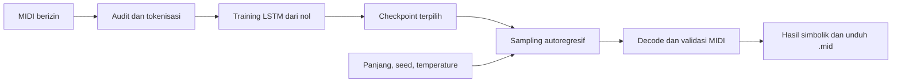

# Nirava — MIDI Music Generator

Proyek Generative AI universitas untuk menghasilkan melodi sebagai rangkaian token musik dan mengekspornya menjadi berkas MIDI. Model utama diusulkan berupa LSTM autoregresif yang **dirancang dan dilatih dari nol** melalui pengembangan bersama LLM.

> **Status: Stage 1 — PIVOT MIDI / GO tertunda.** Repository berisi blueprint dan kontrak teknis. Dataset belum dipilih atau diunduh; model belum dilatih, evaluasi belum dilakukan, dan aplikasi belum diimplementasikan. Arsitektur LSTM masih memerlukan review dosen.

**Daftar isi**

1. [Gambaran Proyek](#gambaran-proyek)
2. [Persyaratan Akademik dan Tujuan Proyek](#persyaratan-akademik-dan-tujuan-proyek)
3. [Cara Kerja Nirava](#cara-kerja-nirava)
4. [Fitur Utama yang Direncanakan](#fitur-utama-yang-direncanakan)
5. [Arsitektur Model](#arsitektur-model)
6. [Teknologi](#teknologi)
7. [Struktur Proyek](#struktur-proyek)
8. [Peran dan Tanggung Jawab Tim](#peran-dan-tanggung-jawab-tim)
9. [Branch Git dan Alur Kolaborasi](#branch-git-dan-alur-kolaborasi)
10. [Roadmap dan Status Pengembangan](#roadmap-dan-status-pengembangan)
11. [Memulai](#memulai)
12. [Evaluasi dan Luaran Akademik](#evaluasi-dan-luaran-akademik)
13. [Indeks Dokumentasi](#indeks-dokumentasi)
14. [Keterbatasan yang Diketahui](#keterbatasan-yang-diketahui)

## Gambaran Proyek

Nirava ditujukan untuk mahasiswa dan pemusik pemula yang membutuhkan ide melodi pendek untuk diedit lebih lanjut dalam Digital Audio Workstation (DAW). Pengguna direncanakan memilih panjang melodi, seed, dan temperature, kemudian menerima hasil simbolik serta berkas `.mid`.

MIDI merepresentasikan peristiwa musik seperti pitch, waktu, dan durasi nada. Luaran proyek adalah data musik simbolik; sintesis rekaman audio tidak termasuk MVP. Scope akademik aktif adalah **Generative Audio & Sequence — MIDI String Generator**.

## Persyaratan Akademik dan Tujuan Proyek

Penugasan dosen yang disampaikan tim adalah:

> Generative Audio (MIDI String Generator): Model mengenerate rangkaian nada musik tanpa pemrosesan berkas biner .wav yang berat.

Tujuan proyek mencakup penyiapan data MIDI yang sah, perancangan tokenisasi dan model, training dari inisialisasi acak, eksperimen hyperparameter, serta evaluasi yang dapat ditelusuri. Seluruh bobot utama, termasuk embedding, harus dilatih tim; integrasi model pretrained tidak memenuhi tujuan ini.

Pengembangan mengikuti metode Vibe Coding: anggota mengarahkan LLM, menilai saran teknis, memverifikasi perubahan, dan menyimpan percakapan serta analisis debugging. Implementasi dari repository atau tutorial eksternal tidak boleh disalin. Dokumen resmi pustaka dapat menjadi referensi operasi dasar sesuai batas yang disetujui dosen.

Pemilihan domain MIDI tidak otomatis menyetujui LSTM, kompleksitas model, atau dimulainya implementasi. Lihat [aturan kerja](AGENTS.md) dan [checklist persetujuan dosen](docs/LECTURER_APPROVAL.md).

## Cara Kerja Nirava

Pipeline berikut adalah **rancangan**, belum sistem yang berjalan.



Training dilakukan offline dengan pemisahan data berdasarkan karya dan keluarga aransemen. Saat generasi, model memprediksi token berikutnya dari token sebelumnya. Decoder menerjemahkan sequence menjadi event MIDI, lalu parser memeriksa berkas hasil sebelum tersedia untuk diunduh.

## Fitur Utama yang Direncanakan

| Fitur | Lingkup MVP |
|---|---|
| Kontrol generasi | Pilihan 4, 8, atau 16 bar; seed dan temperature terbatas |
| Status pemrosesan | Pending, processing, completed, failed, atau expired dengan pesan jujur |
| Pemeriksaan hasil | Note grid/piano-roll, jumlah nada, versi model, dan alasan terminasi |
| Unduh MIDI | Berkas `.mid` monofonik, satu track piano |
| Akses sementara | Token akses job, expiry, dan cleanup berkas privat |

Semua fitur tersebut masih direncanakan. Upload file pengguna, rendering audio, polyphony, multitrack, akun, billing, dan training melalui UI berada di luar MVP. Detail acceptance ada pada [PRD](docs/PRD.md).

## Arsitektur Model

Kandidat utama adalah **`nirava-midi-lstm-v1`**, LSTM unidirectional dengan sel yang diusulkan ditulis tim menggunakan operasi dasar PyTorch dan autograd.

| Komponen | Spesifikasi awal yang diusulkan |
|---|---|
| Vocabulary | 133 token: 128 pitch `NOTE`, `HOLD`, `REST`, `PAD`, `BOS`, dan `EOS` |
| Representasi waktu | Grid 16 langkah per bar, meter 4/4 |
| Model | Embedding 64 → dua layer LSTM hidden 128 → linear head 133 |
| Input training | ID token integer `[B, T]`, panjang window awal `T = 128` |
| Output | Logits `[B, T, 133]` untuk prediksi token berikutnya |
| Objective | Next-token cross entropy, padding tidak dihitung dalam loss |
| Ekspor | SMF type 0, satu track, 120 BPM, PPQ 480, velocity 80 |

Konfigurasi ini belum diuji atau dinyatakan optimal. Sampling memakai temperature, top-k, batas panjang, dan grammar token. Terminasi karena batas panjang harus dilaporkan sebagai `length_cap`, bukan dianggap bukti bahwa model mempelajari akhir musik secara alami.

Rumus, state recurrent, token IDs, dan rekonstruksi tersedia di [arsitektur ML](docs/ML_ARCHITECTURE.md) serta [spesifikasi tokenisasi MIDI](docs/MIDI_TOKENIZATION.md).

## Teknologi

| Lapisan | Teknologi target | Tanggung jawab |
|---|---|---|
| Frontend | Next.js + TypeScript | Parameter, status, hasil simbolik, download |
| Backend | FastAPI + Python | Job, otorisasi, sampling, validasi dan ekspor MIDI |
| Model | PyTorch | Model dari nol, training offline dan inference |
| Database | PostgreSQL | Metadata job, bukan bytes MIDI atau weights |
| Storage | Penyimpanan privat sementara | Berkas MIDI hasil generasi |

Next.js hanya memanggil FastAPI. Migrasi database direncanakan melalui Alembic setelah implementasi diizinkan. Versi dependensi dan kebutuhan perangkat belum ditetapkan. Lihat [arsitektur aplikasi](docs/ARCHITECTURE.md).

## Struktur Proyek

Struktur yang **tersedia saat ini**:

```text
.
├── README.md
├── AGENTS.md
├── .env.example
├── .gitignore
└── docs/
    ├── PRD.md
    ├── ML_ARCHITECTURE.md
    ├── MIDI_TOKENIZATION.md
    ├── DATA_CONTRACT.md
    ├── TRAINING_CONTRACT.md
    └── archive/speech-blueprint/
```

Folder aplikasi, trainer, dan tes belum dibuat. Daftar di atas menampilkan dokumen inti; indeks lengkap ada di bawah. Arsip speech dipertahankan untuk riwayat dan review, **bukan spesifikasi proyek aktif**.

## Peran dan Tanggung Jawab Tim

Nama dan NIM anggota belum dicantumkan; pembagian berikut mengikuti empat job desk akademik.

| Anggota | Peran | Tanggung jawab utama |
|---|---|---|
| Member 1 | Prompt Engineer & LLM Navigator / Ketua | Strategi prompt, scope, tokenisasi, arsitektur, review kontrak dan konsultasi dosen |
| Member 2 | Data Pipeline & Preprocessing Engineer | Lisensi data, parsing, deduplikasi karya, split, tokenisasi dan manifest |
| Member 3 | Training Loop & Hyperparameter Tuning Engineer | Loop training, loss, checkpoint, eksperimen, evaluasi dan profiling |
| Member 4 | Lead Documentarian & Error Handler | Ekspor chat LLM, kronologi error dan solusi, laporan serta bukti kontribusi |

Setiap anggota menyimpan log sesinya sendiri dan memahami perubahan yang dibuat. Member 4 mengompilasi bukti, sementara review dilakukan lintas anggota. Detail handoff ada pada [matriks tanggung jawab](docs/TEAM_RESPONSIBILITIES.md).

## Branch Git dan Alur Kolaborasi

| Branch | Fokus |
|---|---|
| `main` | Dokumentasi dan perubahan bersama yang telah ditinjau |
| `dev/member-1-architecture` | Arsitektur, kontrak teknis dan koordinasi prompt |
| `dev/member-2-data` | Data pipeline dan preprocessing |
| `dev/member-3-training` | Model, training dan eksperimen |
| `dev/member-4-documentation` | Log LLM, dokumentasi dan pelacakan debugging |

Alur kerja yang disarankan: ambil pembaruan remote, bekerja pada branch peran, buat perubahan terfokus beserta verifikasi dan log LLM, lalu ajukan pull request untuk review anggota lain sebelum penggabungan ke `main`. Ini rekomendasi kolaborasi, bukan klaim bahwa branch protection sudah diaktifkan. Sinkronisasi branch harus mempertahankan commit rekan tim.

Jangan memasukkan dataset berhak cipta/pribadi, weights, `.env`, database dump, atau berkas runtime ke Git. Scope tugas dan izin commit/push mengikuti instruksi pengguna untuk setiap pekerjaan.

## Roadmap dan Status Pengembangan

**Tahap saat ini: M0 / Stage 1.** Blueprint tersedia untuk review; keputusan GO belum diberikan.

| Milestone | Fokus | Status |
|---|---|---|
| M0 | Review model, tokenisasi, scope, hardware, tim dan persetujuan | Berlangsung pada tingkat dokumentasi |
| M1 | Audit dataset, parser/tokenizer, split dan fixtures | Belum dimulai; memerlukan izin |
| M2 | Implementasi model/training minimum dan profiling | Belum dimulai; memerlukan izin |
| M3 | Eksperimen, held-out evaluation dan sampling | Belum dimulai |
| M4 | Integrasi Next.js, FastAPI dan PostgreSQL | Belum dimulai; setelah model layak |
| M5 | Demo nyata, laporan, log LLM dan presentasi individu | Belum dimulai |

Dataset, perangkat, anggaran waktu, dan penerimaan arsitektur masih perlu dikonfirmasi. Pilot sebelum GO memerlukan izin offline terbatas tersendiri; rencana ini tidak mengizinkan coding. Rincian ada pada [roadmap](docs/DEVELOPMENT.md) dan [gate Stage 1](docs/STAGE1_VALIDATION.md).

## Memulai

Repository saat ini dapat ditinjau sebagai paket dokumentasi, belum dijalankan sebagai aplikasi.

1. Baca [AGENTS.md](AGENTS.md) untuk batas pekerjaan dan aturan kontribusi.
2. Pelajari [PRD](docs/PRD.md), [arsitektur ML](docs/ML_ARCHITECTURE.md), dan [tokenisasi](docs/MIDI_TOKENIZATION.md).
3. Gunakan [kontrak data](docs/DATA_CONTRACT.md) dan [kontrak training](docs/TRAINING_CONTRACT.md) untuk review lintas anggota.
4. Lengkapi bukti dan keputusan pada [checklist dosen](docs/LECTURER_APPROVAL.md) serta [validasi Stage 1](docs/STAGE1_VALIDATION.md).

Belum tersedia perintah instalasi, training, atau menjalankan server yang telah diuji. Jangan mengunduh dataset atau memulai implementasi berdasarkan README ini. Setelah gate dan izin dipenuhi, tim akan menetapkan versi environment, dependensi, dataset berlisensi, kebutuhan perangkat, serta instruksi eksekusi yang diverifikasi.

## Evaluasi dan Luaran Akademik

Evaluasi yang direncanakan mencakup:

- **Pembelajaran sequence:** token NLL dan perplexity held-out sebelum grammar masking, dibandingkan baseline unigram train-only.
- **Validitas dan batas generasi:** validitas event/ekspor MIDI, intervensi grammar, note-on/off, serta terminasi alami versus batas panjang.
- **Kualitas dan generalisasi:** variasi pitch/ritme, repetisi, kemiripan dengan data training, dan penilaian musikal pendengar.
- **Kelayakan komputasi:** waktu generasi, token per detik, serta peak RAM/VRAM pada perangkat yang dicatat.

Luaran akademik harus meliputi audit dataset dan split, desain tokenizer/model, loop dan loss, konfigurasi serta grafik eksperimen aktual, checkpoint yang dapat ditelusuri, contoh MIDI, log interaksi/debugging LLM, dan bukti kontribusi empat anggota. **Belum ada skor atau hasil eksperimen yang dilaporkan.** Protokol tersedia di [rencana evaluasi](docs/EVALUATION.md).

## Indeks Dokumentasi

| Dokumen | Isi |
|---|---|
| [AGENTS.md](AGENTS.md) | Aturan kerja dan urutan baca |
| [PRD](docs/PRD.md) | Tujuan produk, MVP dan batas scope |
| [Arsitektur aplikasi](docs/ARCHITECTURE.md) | Hubungan frontend, backend, model dan storage |
| [Arsitektur ML](docs/ML_ARCHITECTURE.md) | Desain LSTM dan tensor interfaces |
| [Tokenisasi MIDI](docs/MIDI_TOKENIZATION.md) | Vocabulary, grid, grammar dan ekspor |
| [Kontrak data](docs/DATA_CONTRACT.md) | Manifest, split, window dan batch |
| [Persyaratan dataset](docs/DATASET_REQUIREMENTS.md) | Kriteria corpus dan checklist audit |
| [Kontrak training](docs/TRAINING_CONTRACT.md) | Loss, eksperimen, checkpoint dan reproduksibilitas |
| [Evaluasi](docs/EVALUATION.md) | Metrik, sampling, listening dan batas klaim |
| [Tanggung jawab tim](docs/TEAM_RESPONSIBILITIES.md) | Peran, bukti dan handoff anggota |
| [Roadmap](docs/DEVELOPMENT.md) | Milestone dan definition of done |
| [Validasi Stage 1](docs/STAGE1_VALIDATION.md) | Blocker dan gate implementasi |
| [Persetujuan dosen](docs/LECTURER_APPROVAL.md) | Proposal singkat dan konfirmasi yang diperlukan |
| [API](docs/API_SPEC.md) | Kontrak generation job yang diusulkan |
| [Skema database](docs/DATABASE_SCHEMA.md) | Proposal metadata dan retensi, belum migrasi |
| [Desain UI](docs/DESIGN_SYSTEM.md) | Aksesibilitas dan arah workspace |
| [Proposal model](docs/MODEL_PROPOSAL.md) | Ringkasan pilihan model |
| [Audit blueprint](docs/BLUEPRINT_AUDIT.md) | Keputusan pivot, perubahan dan risiko |
| [Log LLM](docs/LLM_INTERACTION_LOG.md) | Catatan prompt, reasoning dan riwayat sesi |
| [Arsip speech](docs/archive/speech-blueprint/README.md) | Riwayat rancangan terdahulu yang sudah digantikan |

## Keterbatasan yang Diketahui

- V1 diusulkan monofonik, satu instrumen, meter 4/4, tempo dan velocity tetap; chord, ekspresi dinamis, serta rubato tidak dimodelkan.
- Grid ritme dan filtering MIDI bersifat lossy; ketersediaan corpus legal yang sesuai belum terbukti.
- LSTM dapat menghasilkan repetisi atau menghafal data. Berkas valid dan skor kemiripan rendah tidak menjamin kualitas musik maupun kebebasan hak cipta.
- Keluarga LSTM sudah lama; penerimaannya terhadap ketentuan usia kategori dan tingkat kompleksitas proyek perlu konfirmasi dosen.
- Grammar masking dan forced end membantu validitas hasil, tetapi harus dipisahkan dari kemampuan sequence mentah model.
- Kualitas, latency, kebutuhan memori, dan reproduksibilitas lintas perangkat belum diukur. Nama Nirava juga belum selesai diperiksa untuk penggunaan merek.
