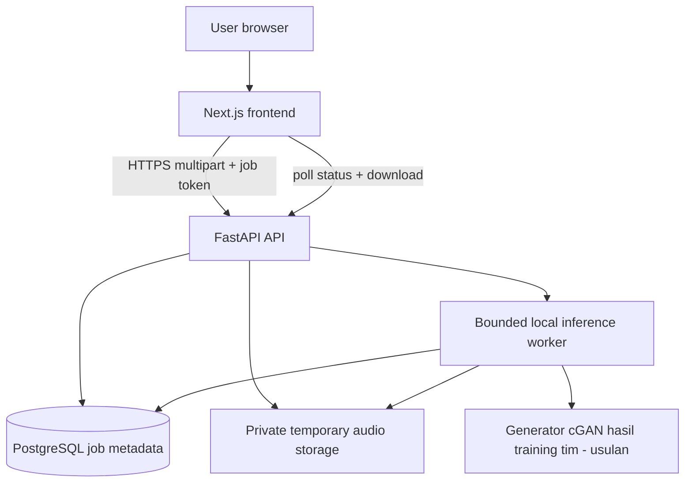

# Architecture (target, not implemented)



## Monorepo target
```
nirava/
  frontend/
    src/app/{layout.tsx,page.tsx,globals.css}
    src/components/{audio,layout,ui}/
    src/hooks/useEnhancementJob.ts
    src/lib/api.ts
    src/types/audio.ts
    public/
    package.json
  backend/
    app/main.py
    app/api/v1/{health.py,enhancement.py}
    app/core/{config.py,security.py}
    app/db/{session.py,models.py}
    app/schemas/enhancement.py
    app/services/{audio.py,enhancer.py,storage.py,model_loader.py,job_runner.py}
    alembic/versions/
    tests/
    pyproject.toml
  infra/compose.yaml
  docs/
  scripts/
  AGENTS.md
  README.md
  .gitignore
  .env.example
```

## Execution
- Satu FastAPI instance dengan worker inference terbatasi untuk demo; PostgreSQL menjaga status tetapi tidak menjalankan pekerjaan.
- Hindari pemrosesan berat langsung pada request thread. Job yang terputus saat restart ditandai gagal saat startup.
- Model dimuat sekali per worker. Atur konkurensi sesuai CPU/GPU.
- Penyimpanan file privat di luar web root, direktori runtime tidak masuk Git.
- Di deployment multi-instance, gunakan object storage + durable queue; jangan anggap filesystem lokal bersama.
- Validasi codec dengan decoder, batasi ukuran dan durasi, terapkan timeout.

## Jalur training offline dan kontrak model

### Spesifikasi Member 1

Kontrak aktif **nirava-stft-cgan-v1** mengusulkan G U-Net Conv2d kecil dengan latent Gaussian dan D patch kondisional, seluruh bobot baru. Spesifikasi matematis/shape, loss dan training handoff berada pada [MODEL_PROPOSAL.md](MODEL_PROPOSAL.md), kontrak batch/manifest A2 pada [DATASET_REQUIREMENTS.md](DATASET_REQUIREMENTS.md). Ini menggantikan kandidat waveform Conv1D 1,024 detik sebelumnya; tidak ada model yang sudah dibangun.

Alur ML: waveform aligned `[B,32000]` mono16kHz → STFT512/hop128/Hann/center → kompleks `[B,257,251]` → RI dibagi sqrt512 `[B,2,257,251]` → network-pad272×256 → G → crop residual RI257×251 → iSTFT length32000 → audio hasil. D membandingkan pasangan RI noisy dan STFT ulang hasil audio/clean dengan shape input `[B,4,257,251]` serta output logit `[B,1,32,31]`. D tidak dideploy. Noisy phase tidak dipakai sebagai pengganti output fase; tanpa pretrained vocoder.

Member 2 memasok waveform/data lineage, Member 3 memiliki transform differentiable dan training loop, Member 1 menjaga versi interface, Member 4 menyimpan bukti prompt/debug/review. Semua konfigurasi preprocessing/inverse dan source/manifest hash menyertai checkpoint. Inference menggunakan chunk2detik/stride1detik, weighted overlap-add dan trim; belum diimplementasikan atau diprofil.

Stage 1 tetap tertutup untuk implementasi. Setelah approval: dataset Kaggle aktif sesuai DATASET_REQUIREMENTS → verifikasi provenance/struktur → pairing terverifikasi atau mixing clean speech + noise yang sah bila tersedia → manifest split speaker/source dan noise → preprocessing berpasangan → training G/D dari nol → validation/eksperimen → checkpoint terpilih → evaluasi test beku → ekspor G untuk worker FastAPI. Jika clean target tidak tersedia, persiapan training ditahan. Discriminator, optimizer, dan data training tidak dibutuhkan oleh layanan inference. Browser tidak mengakses trainer atau storage langsung; tidak menambahkan endpoint training.

Rancangan G/D, objective, konfigurasi awal dan alternatif diffusion dijelaskan pada [MODEL_PROPOSAL.md](MODEL_PROPOSAL.md). Dataset dan gate verifikasi mengikuti [DATASET_REQUIREMENTS.md](DATASET_REQUIREMENTS.md). Target input model mono 16 kHz tidak berarti decoder menerima sample rate/channel tanpa batas; batas upload dan format output tetap perlu validasi.

Artefak training disimpan di luar Git/runtime publik: config, manifest hash, seed, source commit, checkpoint hash, preprocessing version, kurva dan metrik. Catatan nonrahasia dapat masuk dokumentasi; weights/audio tidak. Worker hanya memuat checkpoint tim yang telah dievaluasi, dengan normalisasi, chunking, overlap-add dan trimming sama seperti evaluasi. Catat versi model dalam log operasional aman; perubahan skema jika diperlukan tetap melalui Alembic, belum dilakukan pada task ini.

Next.js hanya memanggil FastAPI; PostgreSQL menyimpan metadata job, bukan audio atau weights. DeepFilterNet opsional untuk eksperimen pembanding terpisah dan tidak menjadi engine utama/fallback tanpa keputusan baru. Tidak ada dependensi atau layanan trainer baru yang dipasang.

## Trade-off
PostgreSQL lebih berat daripada SQLite untuk MVP tetapi dipilih untuk deployment persisten dan pembelajaran skema. Next.js lebih fleksibel untuk desain daripada Streamlit tetapi menambah kompleksitas TypeScript.

## Admission, audio, dan cleanup
- Antrean lokal harus berbatas; tolak dengan 429 sebelum mengembalikan 202 bila kapasitas penuh. Pada restart, tandai pending/processing yang terputus sebagai failed dengan kode aman dan bersihkan file parsial.
- Decoder memvalidasi sample rate positif dan batas channel/sample rate yang disepakati melalui uji model; nilai dukungan masih keputusan Stage 1, bukan kemampuan yang telah diuji. Resampling ke kebutuhan model hanya dilakukan backend, dengan batas decoded samples/memori dan timeout.
- Scheduler cleanup berjalan berkala dan saat startup. Tandai expired sebelum menghapus file; retry kegagalan penghapusan. Worker memeriksa status sebelum mempublikasikan hasil agar tidak menghidupkan job yang dihapus.
- Token/hash, isi audio, dan path privat tidak dicatat pada log. Semua akses job melewati FastAPI.

- Untuk MVP gunakan satu proses API (satu Uvicorn worker) dan satu pengelola antrean lokal berbatas. Banyak proses API tidak boleh masing-masing menjalankan recovery startup terhadap job aktif proses lain.
- Target cleanup: sweep setiap 5 menit serta saat startup; expiry memblokir akses langsung pada request. Batas waktu penghapusan fisik 5 menit hanya target operasi normal, bukan jaminan saat outage. Status expired tidak boleh berubah kembali; hapus output terlambat dan retry saat storage pulih.
