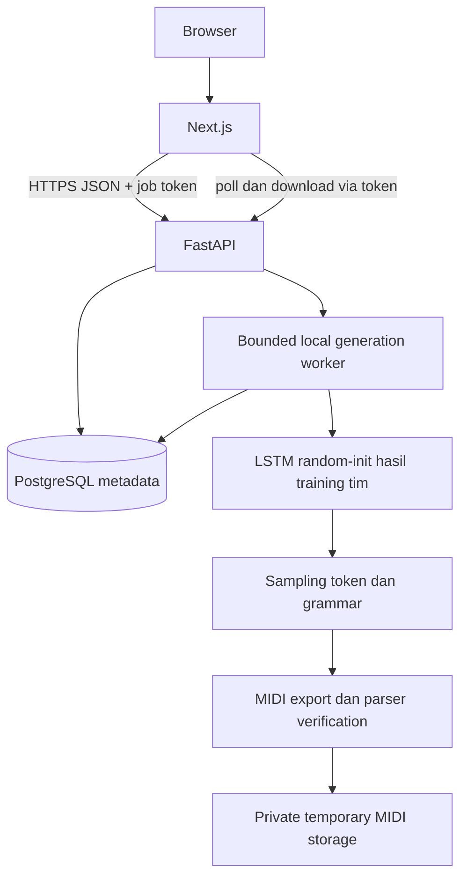

# Architecture Nirava MIDI

Stage1, target belum diimplementasikan. Next.js/TypeScript hanya UI parameter/status/note-grid/download. FastAPI/Python mengelola job, otorisasi, model PyTorch, token sampling dan MIDI export; PostgreSQL metadata dan storage sementara privat untuk .mid.

Offline path: MIDI licensed → audit/parse/canonicalize → work split/token windows → train next-token LSTM → validation/freeze → held-out/sampling/listening → checkpoint/config/vocab → inference worker. Detail [ML_ARCHITECTURE](ML_ARCHITECTURE.md), [MIDI_TOKENIZATION](MIDI_TOKENIZATION.md), [DATA_CONTRACT](DATA_CONTRACT.md), [TRAINING_CONTRACT](TRAINING_CONTRACT.md). Trainer tidak menjadi endpoint produk, D/G adversarial dan storage WAV tidak lagi digunakan.

MVP satu API process, satu queue lokal berbatas, checkpoint dimuat sekali, concurrency awal1 usulan untuk diprofil. Tolak kapasitas penuh429, recovery pending/processing saat restart menjadi failed; worker tidak mempublikasikan setelah expiry/delete. Token capability acak32byte di-hash, UUID bukan otorisasi. Audio/sample rate validation lama diganti JSON bounds, token/event/tick/export parser limits dan timeout. Tidak menerima upload pengguna pada v1.

File MIDI dan weights di luar webroot/Git. Access expiry target24jam dari created_at; cleanup periodik5menit dengan retry dan output terlambat dibuang. Ini target belum diuji. Metadata schema hanya proposal; implementasi migrasi nanti melalui Alembic. Tidak menambah Redis/Celery, multi-instance atau infrastruktur baru tanpa kebutuhan. LSTM compute/memory dan rendering piano-roll belum dibuktikan.
