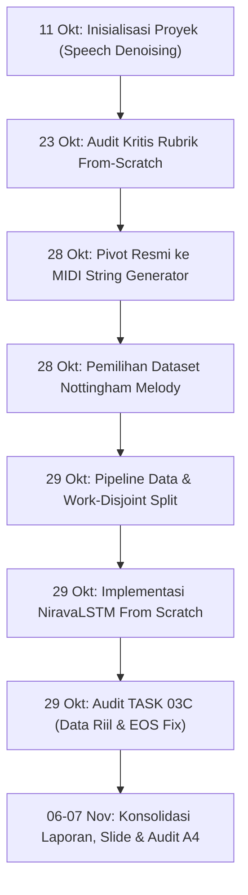

# Garis Waktu Keputusan Besar Proyek Nirava (Decision Timeline)

Dokumen ini merekam secara kronologis setiap keputusan arsitektural dan teknis fundamental yang diambil oleh tim Nirava MIDI Music Generator, mencakup tanggal, alasan keputusan, kompromi teknis (*trade-offs*), serta commit hash terkait di riwayat Git.

---

---

## 1. Rincian Kronologis Keputusan

### Keputusan 1: Inisialisasi Proyek Berbasis Audio Mentah (Speech Denoising)
- **Tanggal:** 11 Oktober 2026
- **Commit Terkait:** `c90b04b` (*Initial commit*)
- **Peran Pemrakarsa:** Muhammad Fajri (A1)
- **Deskripsi Keputusan:** Menetapkan proyek awal bertajuk *AI Voice Cleaner*, berfokus pada penghapusan noise dari sinyal wicara (speech denoising) menggunakan dataset rekaman suara Valentini.
- **Alasan:** Merespons tema umum Generative Audio dengan memanfaatkan stack web modern (Next.js dan FastAPI).
- **Trade-off & Batasan:** Pemrosesan berkas biner `.wav` mentah membutuhkan komputasi STFT/iSTFT yang sangat berat dan ukuran file dataset gigabyte. Arsitektur cGAN atau model deep learning audio mentah sulit dilatih dari inisialisasi acak dalam batas waktu dan sumber daya komputasi laptop mahasiswa.

---

### Keputusan 2: Penolakan Pretrained Baseline & Audit Rubrik From-Scratch
- **Tanggal:** 23 Oktober 2026
- **Commit Terkait:** `f852946`, `56ceba3`, `f5f54d7` (*docs: audit and refine Stage 1 project blueprint*)
- **Peran Pemrakarsa:** Muhammad Fajri (A1)
- **Deskripsi Keputusan:** Mengaudit blueprint awal terhadap panduan resmi dosen (`[CAK4KBB3 2026-1] Panduan Proyek 1 - Vibe Coding.docx`). Menemukan bahwa penggunaan model pretrained seperti *DeepFilterNet* melanggar kewajiban rubrik 30% model dari nol (*from scratch*). Status proyek ditetapkan ke **Stage 1 — GO tertunda**.
- **Alasan:** Menjaga kepatuhan mutlak terhadap kriteria akademik; proyek tidak boleh mengandalkan bobot pretrained eksternal.
- **Trade-off & Batasan:** Menghentikan sementara rencana implementasi frontend/backend sebelum model generatif from-scratch tervalidasi.

---

### Keputusan 3: Pivot Resmi ke MIDI String Generator (TASK 01)
- **Tanggal:** 28 Oktober 2026
- **Commit Terkait:** `d1259a2`, `03732fb`, `02ff463`, `758fbb3` (*docs: pivot Nirava to from-scratch MIDI LSTM generation*)
- **Peran Pemrakarsa:** Tim Nirava (A1 memimpin dokumentasi pivot)
- **Deskripsi Keputusan:** Mengalihkan domain proyek dari pemrosesan audio biner WAV ke **Generative Audio & Sequence — MIDI String Generator**. Sebanyak 19 berkas dokumentasi speech lama diarsipkan ke `docs/archive/speech-blueprint/`. Ditetapkan kontrak representasi token `nirava-midi-step-v1` dengan vocabulary 133 simbol (128 pitch, PAD, BOS, EOS, REST, HOLD) dan kuantisasi 16 langkah per birama (meter 4/4, tempo 120 BPM).
- **Alasan:** Sesuai arahan penugasan resmi: *"Model mengenerate rangkaian nada musik tanpa pemrosesan berkas biner .wav yang berat."* Representasi simbolik MIDI memungkinkan pelatihan model autoregresif dari inisialisasi acak dengan kebutuhan RAM/VRAM yang terjangkau.
- **Trade-off & Batasan:** Model v1 dibatasi secara ketat pada melodi monofonik satu track (tanpa chord/polifoni) dan kuantisasi waktu fixed-grid (tidak memodelkan dinamika ekspresi, tempo rubato, atau swing).

---

### Keputusan 4: Pemilihan Dataset Tunggal: Nottingham Melody
- **Tanggal:** 28 Oktober 2026
- **Commit Terkait:** `9c64cbb` (*docs: select Nottingham melody dataset and update audit requirements*)
- **Peran Pemrakarsa:** Pengguna / A1
- **Deskripsi Keputusan:** Memilih folder `MIDI/melody` dari repositori Nottingham Music Database (1.034 file MIDI berlisensi GPLv3) sebagai sumber corpus tunggal.
- **Alasan:** Nottingham menyediakan koleksi melodi instrumen folk Inggris/Amerika yang terstruktur, relatif bersih, dan berorientasi melodi garis tunggal.
- **Trade-off & Batasan:** Sekitar 501 file ditolak karena memiliki birama non-4/4 (seperti 6/8 atau 3/4). Pilihan ini mempersempit cakupan gaya musik tetapi menjamin konsistensi matematis grid tokenisasi v1.

---

### Keputusan 5: Pipeline Data Monofonik & Work-Disjoint Splitting (TASK 02)
- **Tanggal:** 28–29 Oktober 2026
- **Commit Terkait:** `216aed4`, `4c48d2f`, `4730635` (*feat(member-2): complete data pipeline*)
- **Peran Pemrakarsa:** Muhammad Izza Haikal (A2)
- **Deskripsi Keputusan:** Mengembangkan parser SMF internal tanpa library eksternal berat; memperbaiki penolakan palsu pitch-bend netral (8192); mengeliminasi 2 duplikat identik; membagi dataset menjadi 414 train, 52 val, dan 51 test berdasarkan *work group* (keluarga variasi lagu) untuk mencegah kebocoran data (*data leakage*).
- **Alasan:** Memastikan data uji (*held-out test set*) benar-benar merepresentasikan lagu yang belum pernah dilihat model, bukan sekadar variasi aransemen dari lagu yang ada di set pelatihan.
- **Trade-off & Batasan:** Membutuhkan algoritma pengelompokan work group berbasis kesamaan judul dan token, yang membatasi ukuran set evaluasi menjadi 517 karya unik.

---

### Keputusan 6: Implementasi NiravaLSTMCell Manual From Scratch (TASK 03)
- **Tanggal:** 29 Oktober 2026
- **Commit Terkait:** `2f67f17` (*feat(member-3): complete LSTM from-scratch training engine*)
- **Peran Pemrakarsa:** Taura Muhammad Sanubari (A3)
- **Deskripsi Keputusan:** Mengimplementasikan sel LSTM kustom (`NiravaLSTMCell`) menggunakan matriks linear PyTorch dasar (`W_ih`, `W_hh`, bias) dan fungsi aktivasi manual (sigmoid, tanh) tanpa menggunakan modul black-box `torch.nn.LSTM`. Menerapkan *Masked Cross-Entropy Loss* dengan `ignore_index=0` (PAD).
- **Alasan:** Memenuhi ketentuan mutlak dari-nol pada rubrik penilaian akademik.
- **Trade-off & Batasan:** Eksekusi perulangan sekuensial sel manual di Python murni lebih lambat dibandingkan kernel C/cuDNN bawaan PyTorch, namun memberikan transparansi operasional 100% dan verifikasi matematis yang dapat diaudit.

---

### Keputusan 7: Audit Kritis TASK 03C — Pembersihan Synthetic Fallback & Koreksi EOS
- **Tanggal:** 29 Oktober 2026
- **Commit Terkait:** `7c1a259` (*feat(member-3): TASK 03C audit synthetic fallback, real Nottingham training, EOS mask fix*)
- **Peran Pemrakarsa:** Taura Muhammad Sanubari (A3)
- **Deskripsi Keputusan:**
  1. Menghapus logika fallback diam-diam ke data sintetis pada `src/run_experiments.py` dan mewajibkan file token Nottingham riil.
  2. Melatih ulang R0 (Baseline Unigram), R1 (Usulan Utama), R2, dan R3 pada dataset riil, membuktikan keunggulan R1 (Val NLL 1.1955 vs Baseline 1.5182).
  3. Memperbaiki bug sampling pemotongan melodi prematur dengan *grammar mask* pada token `EOS`.
- **Alasan:** Menghindari penipuan metrik akademik; memastikan hasil yang dilaporkan kepada dosen 100% berasal dari dataset nyata Nottingham.
- **Trade-off & Batasan:** Memerlukan waktu komputasi ekstra untuk melatih ulang seluruh konfigurasi, tetapi menjamin validitas ilmiah laporan.

---

### Keputusan 8: Konsolidasi Bukti, Tata Kelola A4 & Pelaporan Terpadu
- **Tanggal:** 6–7 November 2026
- **Commit Terkait:** `264f783`, `5bb7b80`, dan Branch `dev/member-4-documentation`
- **Peran Pemrakarsa:** Muhammad Fajri (A1 / draft laporan awal) & Muhammad Alif Italiano Syaiza (A4 / finalisasi audit)
- **Deskripsi Keputusan:** Menyusun laporan proyek yang ramah pembaca (`report/README.md`), slide presentasi 16 halaman (`report/Nirava-Presentasi.pptx`), rekap arahan 4 dev, serta audit independen A4 mencakup inventaris bukti, log error, dan review reproduksibilitas.
- **Alasan:** Memenuhi kelengkapan rubrik 25% log interaksi AI, 20% kerja tim, serta persiapan presentasi kelompok.
- **Trade-off & Batasan:** Menyatakan secara transparan keterbatasan model saat ini (evaluasi test set akhir dan blind listening test belum terlaksana; checkpoint biner tidak di-commit ke Git).

