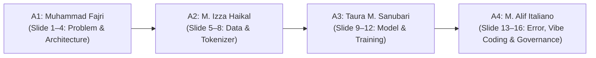

# Panduan & Catatan Presentasi 4 Anggota (Individual Presentation Notes)

**Proyek:** Nirava — MIDI Music Generator  
**Penyusun:** Muhammad Alif Italiano Syaiza (A4 / Lead Documentarian & Error Handler)  
**Target Pengguna:** Muhammad Fajri (A1), Muhammad Izza Haikal (A2), Taura Muhammad Sanubari (A3), Muhammad Alif Italiano Syaiza (A4)  
**Media Presentasi:** Slide PowerPoint 16 Halaman (`report/Nirava-Presentasi.pptx`)

Dokumen ini disusun untuk memastikan setiap anggota menguasai domain perannya secara mendalam, memahami alur teknis, mampu menjawab pertanyaan kritis dosen pengampu, dan bersikap transparan terhadap keterbatasan proyek.

---



---

## 1. Anggota 1: Muhammad Fajri (Prompt Engineer & LLM Navigator / Ketua)
*Alokasi Slide: Slide 1 s.d. 4 (Latar Belakang, Problem Statement, Arsitektur Sistem, dan Kontrak Teknis)*

### A. Tujuan Peran
Memimpin arah strategis proyek, mengarahkan prompt perancangan arsitektur kepada LLM, merumuskan spesifikasi kontrak antarmuka (`ML_ARCHITECTURE.md`, `DATA_CONTRACT.md`, `TRAINING_CONTRACT.md`), serta memfasilitasi keputusan pivot domain.

### B. 5–7 Poin Kunci yang Harus Dijelaskan
1. **Latar Belakang Proyek:** Mahasiswa dan musisi pemula kerap mengalami kebuntuan ide melodi (*creative block*). Nirava hadir untuk menghasilkan ide melodi simbolik MIDI pendek yang dapat langsung diedit di aplikasi DAW.
2. **Alasan Pivot dari Speech ke MIDI:** Proyek awal (speech denoising) memerlukan pemrosesan sinyal biner WAV mentah yang berat dan berisiko melanggar syarat model from scratch jika memakai pretrained (DeepFilterNet). Domain dialihkan ke *Generative Audio Sequence — MIDI String Generator* sesuai arahan penugasan resmi.
3. **Representasi Monofonik Step-Based:** Memilih grid waktu diskret 16 langkah per birama (meter 4/4) dengan 133 token (128 pitch, PAD, BOS, EOS, REST, HOLD).
4. **Desain Model Unidirectional Autoregresif:** Model membaca urutan prefix token masa lalu dan memprediksi distribusi probabilitas token berikutnya $p(t_k \mid t_{<k})$.
5. **Filosofi From Scratch:** Menolak keras penggunaan pretrained weights, transfer learning, atau modul neural network bawaan tingkat tinggi; model diinisialisasi acak dan dilatih murni dari data tim.
6. **Batas Lingkup MVP yang Tegas:** MVP dibatasi pada melodi 1 track piano, monofonik, fixed tempo 120 BPM, tanpa sintesis audio WAV, dan tanpa fitur upload pengguna.

### C. Alur Kerja (Input → Proses → Output)
- **Input:** Kebutuhan fungsional dan batasan rubrik akademik dari panduan resmi dosen.
- **Proses:** Merancang arsitektur model dan representasi token melalui prompt bertahap kepada LLM; menyusun kontrak formal antaranggota; mengarsipkan riwayat speech.
- **Output:** Dokumen spesifikasi kontrak terpadu (`nirava-midi-step-v1`, `nirava-midi-lstm-v1`, `PRD.md`, `README.md`).

### D. Keputusan Penting & Alasan Teknis
- **Keputusan:** Membatasi model pada representasi monofonik 133 token.
- **Alasan:** Memungkinkan pelatihan model autoregresif yang stabil dan konvergen pada komputasi CPU/laptop tanpa memerlukan GPU server kelas industri.
- **Trade-off:** Tidak dapat memodelkan akord polifonik dan nuansa dinamika permainan (velocity/pedal).

### E. Error Nyata & Solusi
- **Kendala:** Konflik izin penulisan Git refs dan penguncian berkas panduan DOCX saat dibaca proses Word.
- **Solusi:** Menyesuaikan akses terminal dan menggunakan metode pembacaan `FileShare.ReadWrite` untuk membaca panduan tanpa mematikan aplikasi lokal.

### F. Keterbatasan Jujur
- Model tidak memiliki memori jangka panjang untuk struktur lagu kompleks (seperti verse-chorus).
- Tahap Stage 1 masih berstatus "GO tertunda" secara administratif di repository, menunggu persetujuan resmi dosen.

### G. 5 Kemungkinan Pertanyaan Dosen & Jawaban Berbasis Dokumen
1. *T: Mengapa kelompok Anda beralih (pivot) dari Speech Denoising ke MIDI Music Generator?*  
   **J:** Berdasarkan evaluasi terhadap panduan Vibe Coding, speech denoising berbasis WAV mentah sulit dilatih dari inisialisasi acak tanpa pretrained baseline. Penugasan resmi dosen mengarahkan ke Generative Audio (MIDI String Generator) untuk memodelkan rangkaian nada tanpa komputasi file biner audio yang berat.
2. *T: Mengapa memilih arsitektur LSTM dan bukan Transformer atau Diffusion?*  
   **J:** LSTM memiliki kompleksitas komputasi $\mathcal{O}(T)$ per step yang jauh lebih ringan dibanding self-attention $\mathcal{O}(T^2)$, sangat sesuai untuk dataset melodi pendek (128 langkah) dan memungkinkan implementasi sel rekuren manual dari nol menggunakan operasi matriks dasar PyTorch.
3. *T: Mengapa vocabulary Anda berukuran tepat 133 token?*  
   **J:** Vocabulary terdiri dari 128 pitch standar MIDI (0–127) yang diawali token `NOTE_`, ditambah 5 token kontrol: PAD (0), BOS (1), EOS (2), REST (3), dan HOLD (4). Total = $128 + 5 = 133$ simbol.
4. *T: Bagaimana Anda memastikan tidak ada kode pretrained yang disalin?*  
   **J:** Seluruh tensor bobot diinisialisasi secara acak dengan distribusi normal terpotong; tidak ada modul `torchvision`, `torchaudio`, Hugging Face, atau pretrained checkpoint yang diunduh.
5. *T: Apa peran dokumen kontrak kerja antaranggota?*  
   **J:** Memastikan pemisahan tanggung jawab yang modular; A2 hanya fokus menghasilkan token yang sesuai kontrak `nirava-midi-data-v1`, dan A3 hanya menerima input tensor sesuai kontrak tanpa saling merusak kode modul lain.

---

## 2. Anggota 2: Muhammad Izza Haikal (Data Pipeline & Preprocessing Engineer)
*Alokasi Slide: Slide 5 s.d. 8 (Dataset Nottingham, Filter Monofonik, Tokenizer 133, dan Work-Disjoint Splitting)*

### A. Tujuan Peran
Membangun pipeline pengolahan data MIDI dari mentah hingga siap latih tanpa pustaka pihak ketiga eksternal, melakukan filtering kualitas musik, serta menjamin tidak adanya kebocoran data (*data leakage*).

### B. 5–7 Poin Kunci yang Harus Dijelaskan
1. **Corpus Nottingham Melody:** Memilih folder `MIDI/melody` (1.034 file MIDI berlisensi GPLv3) yang merupakan koleksi melodi folk tradisional.
2. **Kriteria Seleksi Ketat:**
   - Ditolak karena meter selain 4/4: **501 file** (misal 6/8 atau 3/4).
   - Ditolak karena overlap nada pada grid: **14 file** (nada bertumpuk non-monofonik).
   - Berhasil di-encode: **519 file**.
   - Dieliminasi karena duplikat token identik: **2 file**.
   - Dataset final resmi: **517 karya unik**.
3. **Zero External MIDI Libraries:** Seluruh parser SMF Type 0/1 dibangun dari nol menggunakan modul standar Python `struct`, membaca chunk `MThd` dan `MTrk` secara presisi.
4. **Kuantisasi Grid 16 Step/Birama:** Durasi per step adalah 1/16 birama (1 sixteenth note). Nada yang dimainkan dipetakan ke step awal (`NOTE`), step perpanjangan (`HOLD`), atau jeda diam (`REST`).
5. **Round-Trip Consistency 100%:** Seluruh 519 file yang ter-encode berhasil di-decode kembali menjadi MIDI dan diverifikasi identik secara struktural.
6. **Work-Disjoint Splitting:** Mengelompokkan karya berdasarkan kemiripan judul dan n-gram melodi (494 work groups). Pembagian (414 train, 52 val, 51 test) menjamin melodi dari rumpun karya yang sama tidak pernah bocor lintas split.

### C. Alur Kerja (Input → Proses → Output)
- **Input:** File mentah `.mid` dari Nottingham folder `melody`.
- **Proses:** Parsing SMF binary → filter meter 4/4 → deteksi monofoni → kuantisasi grid → tokenisasi 133 simbol → deduplikasi → pengelompokan work groups → windowing stride 128.
- **Output:** Berkas `processed/tokens_v1.jsonl` dan manifest `reports/split_manifest.csv`.

### D. Keputusan Penting & Alasan Teknis
- **Keputusan:** Menolak seluruh file dengan meter non-4/4 (501 file).
- **Alasan:** Menjaga representasi grid waktu diskret 16 langkah per birama tetap seragam tanpa interpolasi pecahan tick yang rumit.

### E. Error Nyata & Solusi
- **Error (ERR-01):** Seluruh file 4/4 awalnya ditolak dengan alasan *"pitch bend aktif"*.
- **Akar Masalah:** File Nottingham memiliki event pitch-bend netral (value 8192) di tick 0. Parser awal mendeteksi keberadaan event bend tanpa mengecek apakah nilainya netral.
- **Solusi:** Memperbarui parser agar nilai 8192 (netral) dan pedal CC64 < 64 (off) diterima. Sebanyak 519 file langsung berhasil di-encode.

### F. Keterbatasan Jujur
- Dataset memiliki bias kuat pada musik folk Inggris/Amerika dalam skala mayor/minor sederhana.
- Kuantisasi 16 step/bar mengabaikan ekspresi ketukan mikro seperti swing jazz atau triplet nada ganjil.

### G. 5 Kemungkinan Pertanyaan Dosen & Jawaban Berbasis Dokumen
1. *T: Mengapa dari 1.034 file Nottingham, hanya 517 file yang digunakan?*  
   **J:** 501 file ditolak karena memiliki birama non-4/4 (seperti 6/8 atau 3/4), 14 file ditolak karena memiliki nada polifonik/bertumpuk pada grid, dan 2 file dibuang karena merupakan duplikat identik persis. Total melodi valid dan unik adalah 517 file.
2. *T: Apa yang dimaksud dengan split work-disjoint dan mengapa penting?*  
   **J:** Lagu folk sering memiliki beberapa versi aransemen atau judul mirip (misalnya `ashover20` dan `ashover22`). Jika di-split acak per file, model bisa menghafal variasi lagu latih saat evaluasi. Work-disjoint mengelompokkan keluarga lagu ke dalam 494 grup, memastikan satu famili karya hanya berada di train, val, atau test secara eksklusif (0 leakage).
3. *T: Mengapa ada perbedaan angka 515 pada audit awal dan 517 pada manifest split?*  
   **J:** Skrip audit pra-pemrosesan awal menghitung overlap nada pada tick mikro kontinu sehingga 2 file (`reelsh-l66` dan `xmas4`) ditolak. Pada representasi tokenizer grid 16 step/bar, selisih 1-tick tersebut terpetakan ke slot yang sama tanpa tumpang tindih nada, sehingga kedua file terbukti sah monofonik.
4. *T: Mengapa tidak memakai library seperti PrettyMIDI atau Mido?*  
   **J:** Sesuai prinsip Vibe Coding dari nol dan zero-external dependencies, parser biner ditulis murni menggunakan modul bawaan `struct` Python. Ini membuktikan pemahaman mendalam mahasiswa terhadap spesifikasi protokol biner MIDI Standard MIDI File (SMF).
5. *T: Bagaimana cara menangani token PAD pada windowing?*  
   **J:** Melodi dipotong dengan window panjang 128 dan stride 128. Jika window terakhir tidak mencapai 128 token, sisa panjang diisi token `PAD` (ID 0) dan dibuatkan `loss_mask` bernilai `False` agar gradien padding tidak dihitung saat training.

---

## 3. Anggota 3: Taura Muhammad Sanubari (Training Loop & Hyperparameter Tuning Engineer)
*Alokasi Slide: Slide 9 s.d. 12 (Arsitektur Model From Scratch, Masked CE Loss, Hasil Evaluasi R0–R5, dan Kurva Konvergensi)*

### A. Tujuan Peran
Membangun arsitektur model recurrent `NiravaLSTM` dari inisialisasi acak tanpa modul blackbox, mengimplementasikan fungsi loss kustom, mengelola checkpoint deterministik, serta mengeksekusi eksperimen ablasi.

### B. 5–7 Poin Kunci yang Harus Dijelaskan
1. **NiravaLSTMCell Manual:** Diimplementasikan dari nol menggunakan tensor linear dasar ($W_{ih}, W_{hh}, b_{ih}, b_{hh}$) dengan gerbang input ($i$), forget ($f$), cell ($g$), dan output ($o$) sesuai persamaan recurrent LSTM standar.
2. **Spesifikasi Parameter Model (R1):** Embedding dimension 64, 2 layer recurrent hidden size 128, linear head ke 133 logits. Total parameter: **256.069 parameter**.
3. **Masked Cross-Entropy Loss:** Menghitung loss next-token cross entropy dengan mengabaikan kontribusi token PAD (`ignore_index=0`), serta menghitung rata-rata NLL berbasis jumlah token target riil (*token-weighted*).
4. **Hasil Ablation Study (Kuantitatif):**
   - **R0 (Baseline Unigram):** Val NLL = 1.5182, Perplexity = 4.56.
   - **R1 (Model Usulan Utama H=128, LR 1e-3):** Val NLL = **1.1955**, Perplexity = **3.31** (Mengungguli baseline secara signifikan).
   - **R2 (Ablasi LR Konservatif LR 3e-4):** Val NLL = 1.4074, Perplexity = 4.09.
   - **R3 (Ablasi Kapasitas Kecil H=64):** Val NLL = 1.2489, Perplexity = 3.49.
5. **Autoregressive Sampling dengan Grammar Mask:** Generasi token step-by-step menggunakan sampling multinomial berbobot temperatur; token ilegal (seperti HOLD sebelum ada NOTE, atau EOS dini sebelum 1 bar) di-masking ke $-\infty$.
6. **Deterministik & Checkpoint Integritas:** Dilengkapi seed RNG tetap dan verifikasi integritas checkpoint (`nirava-midi-checkpoint-v1`) mencakup hash tokenizer.

### C. Alur Kerja (Input → Proses → Output)
- **Input:** Batch tensor token `[B, 128]` dari DataLoader Member 2.
- **Proses:** Embedding lookup → perulangan waktu sel LSTM manual → hidden states → linear projection → Masked Cross Entropy Loss → backpropagation via PyTorch autograd → Adam optimizer dengan gradient clip 1.0.
- **Output:** Checkpoint bobot `runtime/nirava_midi_lstm_v1_export.pt` dan file melodi hasil generasi `.mid`.

### D. Keputusan Penting & Alasan Teknis
- **Keputusan:** Menolak pemakaian `torch.nn.LSTM` bawaan dan menulis manual cell loop.
- **Alasan:** Memenuhi rubrik orisinalitas 30% model dari nol dan memastikan setiap gerbang rekuren dapat diaudit secara matematis.

### E. Error Nyata & Solusi
- **Error 1 (ERR-03 - Silent Synthetic Fallback):** Runner eksperimen sempat secara otomatis menjalankan data dummy saat file token riil belum dibuat.
  - *Solusi (TASK 03C):* Menghapus fallback diam-diam, mewajibkan flag eksplisit `--synthetic-smoke-test`, dan melatih ulang R0–R3 pada 517 karya riil Nottingham.
- **Error 2 (ERR-04 - Premature EOS Termination):** Melodi terputus di langkah ke-2 karena model memilih EOS saat temperatur tinggi.
  - *Solusi:* Memasang grammar mask yang melarang pemilihan EOS sebelum minimal 1 birama (16 langkah) selesai di-generate.

### F. Keterbatasan Jujur
- Model dilatih pada dataset berukuran sedang (~231.000 token) sehingga kapasitas generalisasi gaya baru terbatas.
- Evaluasi test set (51 karya) belum dibuka (*frozen*) dan belum dilakukan uji dengar subjektif oleh musisi manusia.

### G. 5 Kemungkinan Pertanyaan Dosen & Jawaban Berbasis Dokumen
1. *T: Bagaimana Anda membuktikan bahwa model Anda benar-benar belajar dan tidak sekadar menebak frekuensi token terbanyak?*  
   **J:** Dibuktikan dengan membandingkan performa model terhadap Baseline Unigram R0. Baseline unigram menghasilkan Val NLL 1.5182 (PPL 4.56), sedangkan model LSTM R1 mencapai Val NLL 1.1955 (PPL 3.31). Penurunan NLL sebesar ~0.32 membuktikan model berhasil menangkap ketergantungan urutan transisi antar-nada, bukan hanya frekuensi statis.
2. *T: Jelaskan formula Masked Cross-Entropy Loss yang Anda gunakan!*  
   **J:** Loss dihitung dengan rumus:
   $$\mathcal{L} = -\frac{1}{\sum_{i,t} m_{i,t}} \sum_{i=1}^B \sum_{t=1}^T m_{i,t} \log p(y_{i,t} \mid x_{i,\le t})$$
   di mana $m_{i,t} = 1$ jika target bukan PAD, dan $0$ jika target adalah PAD. Hal ini mencegah model mendapatkan penalti gradien dari token padding.
3. *T: Mengapa tidak menggunakan CrossEntropyLoss standar PyTorch?*  
   **J:** `torch.nn.CrossEntropyLoss(ignore_index=0)` dapat digunakan, namun untuk menghitung perplexity yang akurat lintas batch yang berbeda panjang, akumulasi NLL harus dinormalisasi terhadap total token non-PAD secara global, bukan dirata-rata per baris batch.
4. *T: Apa pengaruh variasi temperature pada sampling generasi melodi (R5)?*  
   **J:** Temperature mengontrol keacakan distribusi softmax logits:
   - Temp 0.8: Distribusi tajam, melodi sangat konservatif (rata-rata 32 nada, minim lompatan interval).
   - Temp 1.0: Variasi nada seimbang (rata-rata 37 nada).
   - Temp 1.2: Distribusi lebih datar, lompatan nada lebih dinamis dan luas (rata-rata 48 nada).
5. *T: Mengapa eksperimen R4 tidak ada dalam tabel hasil?*  
   **J:** Eksperimen R4 awalnya direncanakan untuk variasi kapasitas besar/dropout, namun ditiadakan untuk menghemat budget komputasi CPU dan langsung memprioritaskan sampling generasi R5.

---

## 4. Anggota 4: Muhammad Alif Italiano Syaiza (Lead Documentarian & Error Handler)
*Alokasi Slide: Slide 13 s.d. 16 (Penanganan Error Nyata, Vibe Coding Log, Evaluasi Reproduksibilitas, Keterbatasan & Penutup)*

### A. Tujuan Peran
Menjaga akuntabilitas akademik, mengaudit reproduksibilitas eksperimen secara independen, mengompilasi log interaksi AI (Vibe Coding), mendokumentasikan katalog error riil dan penyelesaiannya, serta menyatukan laporan akhir dan materi presentasi kelompok.

### B. 5–7 Poin Kunci yang Harus Dijelaskan
1. **Penjelasan Alur End-to-End Sistem Nirava:** Mampu menguraikan rantai komputasi lengkap dari file mentah hingga unduhan MIDI (lihat Bagian 5).
2. **Kompilasi Bukti Vibe Coding 4 Anggota:** Mengawal ketersediaan log chat AI seluruh anggota (`llm_chat_export_member1` s.d. `member4`) untuk memenuhi bobot 25% rubrik interaksi AI.
3. **Katalog Error Nyata (Tanpa Error Fiktif):** Mengidentifikasi 7 error riil proyek (pitch bend netral, disparitas 515/519/517, silent synthetic fallback, premature EOS, kendala gh CLI, izin Git refs, dan sandbox network).
4. **Audit Reproduksibilitas Empiris:** Berhasil mereproduksi seluruh pipeline dari nol: menjalankan 54 unit tests (100% pass dalam 42.4 detik), meng-encode 519 file, memvalidasi 517 split karya dengan 0 data leakage.
5. **Pemecahan Misteri Selisih Token:** Membuktikan secara matematis bahwa selisih token latih (231.004 vs 230.590) dan validasi (28.152 vs 28.100) disebabkan oleh pengecualian token awal BOS dari target prediksi ($N_{\text{target}} = N_{\text{tokens}} - N_{\text{pieces}}$).
6. **Transparansi Keterbatasan & Isu Terbuka:** Menyajikan daftar jujur hal-hal yang belum selesai (evaluasi test set akhir, user study, otorisasi formal Stage 1) untuk menjaga integritas ilmiah kelompok.

### C. Alur Kerja (Input → Proses → Output)
- **Input:** Riwayat commit Git, berkas laporan A1/A2/A3, kode sumber, pesan error asli di terminal, dan artefak hasil eksekusi.
- **Proses:** Audit lingkungan fresh clone → eksekusi unit test → verifikasi dataset riil → investigasi ketidaksinkronan data → penyusunan matriks kontribusi dan log error → penulisan laporan terpadu.
- **Output:** `docs/llm_chat_export_member4.md`, `docs/ERROR_LOG.md`, `docs/REPRODUCIBILITY_REVIEW.md`, `docs/REVIEW_FINDINGS_A4.md`, `docs/PRESENTATION_NOTES.md`.

### D. Keputusan Penting & Alasan Teknis
- **Keputusan:** Menolak mengarang data eksperimen baru atau mengisi checklist approval dosen secara fiktif.
- **Alasan:** Menegakkan aturan integritas akademik; status "GO tertunda" dan ketiadaan hasil test set dicatat apa adanya sebagai keterbatasan transparan.

### E. Error Nyata & Solusi
- **Error (ERR-06/Fase 4):** Kegagalan instalasi paket `requirements.txt` akibat penguncian versi fiktif `torch==2.15.0+cpu`.
- **Solusi:** Mencatat pesan error asli, mengevaluasi izin aturan nomor 8, dan memasang build resmi `torch>=2.0.0` (`torch==2.14.1+cpu`) di `.venv`, membuktikan sistem dapat berjalan dengan dependensi portabel.

### F. Keterbatasan Jujur
- Bukti chat anggota lain saat ini berupa rekonstruksi terkurasi, belum berupa link share platform langsung.
- Checkpoint biner `.pt` dan file `.mid` tidak dapat disimpan di Git demi mematuhi aturan ukuran repositori.

### G. 5 Kemungkinan Pertanyaan Dosen & Jawaban Berbasis Dokumen
1. *T: Apa peran unik Anggota 4 dalam metodologi Vibe Coding?*  
   **J:** Pada metodologi Vibe Coding, keterlacakan (*traceability*) dan kejujuran proses adalah pilar penilaian utama (bobot 25%). A4 bertindak sebagai auditor independen internal: memastikan seluruh instruksi prompt tersimpan, mencatat error teknis nyata beserta alasan perbaikannya, dan menguji apakah kode yang dihasilkan LLM benar-benar dapat direproduksi di lingkungan bersih tanpa ketergantungan tersembunyi.
2. *T: Bagaimana Anda memverifikasi bahwa kode proyek ini benar-benar bisa dijalankan ulang (reproducible)?*  
   **J:** Saya membuat virtual environment baru dari nol, mengklon repositori Nottingham pada commit revisi tetap `0992bb6`, menjalankan skrip audit tokenizer dan split, serta mengeksekusi 54 unit test. Hasilnya terbukti 100% lulus dalam 42,4 detik dan menghasilkan ringkasan angka yang identik persis dengan artefak laporan anggota sebelumnya.
3. *T: Mengapa di repositori tercatat commit laporan dan presentasi di bawah akun Fajri (Dev 1)?*  
   **J:** Commit `264f783` dan `5bb7b80` merupakan draf awal yang disusun oleh Dev 1 dengan bantuan AI. Sesuai prinsip akuntabilitas, commit tersebut tidak diklaim sebagai pekerjaan A4. Kontribusi A4 dicatat secara mandiri melalui branch `dev/member-4-documentation` dengan akun Git `alifitaliano` melalui audit menyeluruh, log error, review reproduksibilitas, dan panduan presentasi ini.
4. *T: Apa temuan paling kritis yang ditemukan oleh Anggota 4 saat mengaudit pekerjaan tim?*  
   **J:** Ada 3 temuan penting: (1) `requirements.txt` mengunci versi PyTorch non-eksisten (`2.15.0+cpu`) yang menghalangi instalasi bersih; (2) skrip runner training sempat memiliki logika fallback diam-diam ke data sintetis sebelum diperbaiki pada TASK 03C; dan (3) klaim penggunaan istilah "polifonik" pada laporan evaluasi yang bertentangan dengan desain model monofonik.
5. *T: Mengapa hasil evaluasi pada test set (51 karya) belum dilaporkan?*  
   **J:** Sesuai metodologi machine learning yang baik, test set harus dijaga *frozen* (tidak disentuh) selama proses eksplorasi model dan pemilihan hyperparameter pada validation set. Melaporkan test set sebelum model final dibekukan berisiko menimbulkan *information leakage* dan *overfitting* tidak sengaja pada data uji.

---

## 5. Penjelasan Alur End-to-End Sistem Nirava (Wajib Dikuasai A4)

Gunakan penjelasan sederhana dan runtut ini saat diminta menjelaskan cara kerja sistem dari hulu ke hilir:

```text
[Dataset Nottingham] 
        │ (1.034 file MIDI mentah)
        ▼
[Seleksi & Filter Kualitas] 
        │ - Buang birama selain 4/4 (501 file)
        │ - Buang nada bertumpuk/polifonik (14 file)
        │ - Terima pitch bend netral 8192 & pedal off
        ▼
[Tokenizer 133 Simbol] 
        │ - Kuantisasi waktu 16 langkah per birama (120 BPM)
        │ - Ubah nada ke token: NOTE_x (mulai), HOLD (panjangkan), REST (jeda)
        │ - Encode 519 file (100% lolos round-trip SMF Type 0)
        │ - Hapus 2 duplikat identik → 517 karya unik
        ▼
[Work-Disjoint Splitting] 
        │ - Kelompokkan famili melodi ke 494 work groups
        │ - Split: 414 Train / 52 Validation / 51 Test (0 leakage)
        ▼
[Data Windowing & DataLoader] 
        │ - Potong urutan menjadi window panjang 128 dengan stride 128
        │ - Input: x = tokens[:-1] diisi PAD jika kurang
        │ - Target: y = tokens[1:] (shifted right)
        │ - Loss mask: True untuk target aktif, False untuk PAD
        ▼
[Model NiravaLSTM from Scratch] 
        │ - Inisialisasi acak, tanpa bobot pretrained
        │ - Input token ID [B, 128] → Embedding 64 dimensi
        │ - 2 Layer NiravaLSTMCell manual (Hidden dim 128, 256k params)
        │ - Linear projection head → Logits [B, 128, 133]
        ▼
[Training Engine & Masked Loss] 
        │ - Masked Cross-Entropy Loss (mengabaikan PAD)
        │ - Adam optimizer (LR 1e-3, grad clip 1.0)
        │ - Konvergen dalam 8 epoch (Val NLL turun dari 1.5182 ke 1.1955)
        ▼
[Inference & Autoregressive Sampling] 
        │ - Mulai dari token BOS (ID 1)
        │ - Model memprediksi logits token berikutnya
        │ - Terapkan grammar mask (larang EOS dini & HOLD tanpa NOTE)
        │ - Sampling berbasis temperature (0.8, 1.0, 1.2) dan top-k 20
        │ - Ulangi hingga mencapai panjang target (64 / 128 langkah)
        ▼
[Decoder & Ekspor MIDI] 
        │ - Terjemahkan token kembali ke delta-time MIDI events
        │ - Bungkus ke header SMF Type 0, 1 track piano, PPQ 480
        │ - Parser memvalidasi integritas file
        ▼
[Hasil Akhir: File .mid Siap Diputar di DAW]
```

