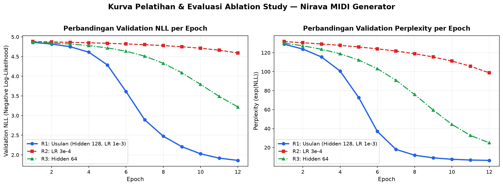

# Nirava — MIDI Music Generator

Laporan proyek Generative Audio & Sequence • Pembaruan 6 November 2026

**Nirava membantu pengguna memperoleh ide melodi pendek dalam bentuk MIDI yang dapat diedit di aplikasi musik.** Model mempelajari urutan nada dari dataset Nottingham, lalu menyusun melodi satu nada pada satu waktu. Fokus akademiknya adalah membangun model dari nol, menyiapkan data dengan benar, membandingkan eksperimen, dan mencatat proses kerja bersama AI.

📊 [Unduh presentasi PowerPoint](Nirava-Presentasi.pptx)

> **Status laporan:** kode pipeline data dan model sudah berada di repository, disertai laporan eksperimen bertanggal 29 Oktober 2026. Aplikasi web masih berupa rancangan. Dokumen Stage 1 masih mencatat GO tertunda. Laporan ini merangkum bukti yang tersedia sampai commit `7c1a259`, bukan persetujuan implementasi dan bukan hasil training ulang pada sesi penyusunan laporan.

## Daftar isi

1. [Latar belakang dan tujuan](#1-latar-belakang-dan-tujuan)
2. [Produk dan batas lingkup](#2-produk-dan-batas-lingkup)
3. [Metode yang digunakan](#3-metode-yang-digunakan)
4. [Data dan pengolahannya](#4-data-dan-pengolahannya)
5. [Model dan pelatihan](#5-model-dan-pelatihan)
6. [Implementasi dan luaran](#6-implementasi-dan-luaran)
7. [Hasil eksperimen dan maknanya](#7-hasil-eksperimen-dan-maknanya)
8. [Penggunaan AI dan penanganan masalah](#8-penggunaan-ai-dan-penanganan-masalah)
9. [Manajemen proyek](#9-manajemen-proyek)
10. [Pembagian peran dan bukti commit](#10-pembagian-peran-dan-bukti-commit)
11. [Keterbatasan dan pekerjaan berikutnya](#11-keterbatasan-dan-pekerjaan-berikutnya)
12. [Sumber dan jejak bukti](#12-sumber-dan-jejak-bukti)

## 1. Latar belakang dan tujuan

Mahasiswa dan pemusik pemula dapat membutuhkan ide awal ketika menyusun melodi. Nirava dirancang untuk memberikan bahan yang bisa ditinjau dan dikembangkan kembali oleh pengguna. MIDI menyimpan informasi nada dan waktunya sehingga pengguna dapat mengganti instrumen atau mengedit komposisi melalui DAW, yaitu aplikasi produksi musik.

Proyek semula membahas pembersihan suara, kemudian beralih ke **MIDI String Generation** sesuai penugasan pengguna pada 28 Oktober 2026. Nama folder repository masih membawa nama proyek lama. Dokumen speech di `docs/archive/speech-blueprint` menjadi riwayat keputusan, bukan acuan produk aktif.

Tujuan akademik proyek:

- Memahami cara model mempelajari hubungan antar nada dan memprediksi kelanjutan urutan.
- Membangun model utama dari inisialisasi acak menggunakan operasi dasar PyTorch.
- Menyusun pengolahan data yang dapat ditelusuri, termasuk penyaringan dan pemisahan karya untuk evaluasi.
- Menilai hasil melalui eksperimen terkontrol serta mengungkap batas penilaiannya.
- Menyimpan interaksi AI, alasan keputusan, masalah aktual, dan kontribusi anggota melalui Git.

## 2. Produk dan batas lingkup

Alur produk yang direncanakan:

**Pilih panjang melodi, seed, dan temperature → minta generasi → lihat status → tinjau susunan nada → unduh MIDI.**

Seed adalah angka untuk mengendalikan pengacakan. Temperature mengatur seberapa beragam pilihan model saat menghasilkan nada. Pengguna tidak memasukkan teks, rekaman suara, atau file MIDI sebagai prompt pada MVP.

| Aspek | Cakupan Nirava |
|---|---|
| Pengguna utama | Mahasiswa dan pemusik pemula yang mencari ide melodi |
| Hasil | Melodi monofonik, yaitu satu nada aktif pada satu waktu |
| Panjang target | 4, 8, atau 16 birama |
| Representasi | Susunan nada/piano-roll dan file `.mid` |
| Karakter hasil | Satu instrumen piano, birama 4/4, tempo ekspor 120 BPM, kekuatan nada tetap |
| Fitur di luar MVP | Chord, banyak track, audio WAV/MP3, pemutaran audio di browser, upload pengguna, akun, dan pembayaran |

MIDI perlu instrumen virtual atau aplikasi musik untuk menjadi bunyi. Kemampuan menghasilkan file yang valid belum membuktikan bahwa melodi enak didengar, baru, atau bebas masalah hak cipta.

## 3. Metode yang digunakan

Nirava memakai **generasi autoregresif**: model membaca urutan yang sudah ada, memprediksi simbol berikutnya, lalu memakai hasil tersebut untuk melanjutkan urutan. Proses berjalan berulang sampai mencapai batas panjang.

Sebelum training, tim mengubah MIDI menjadi simbol yang sederhana:

| Simbol | Makna sederhana |
|---|---|
| NOTE | Mulai nada dengan tinggi tertentu |
| HOLD | Perpanjang nada yang sedang aktif |
| REST | Beri jeda |
| BOS / EOS | Tandai awal dan akhir melodi |
| PAD | Lengkapi panjang contoh saat pengolahan batch |

Satu birama berisi 16 langkah waktu. Representasi ini memiliki 133 simbol. Pilihan tersebut memudahkan pengolahan melodi sederhana, tetapi mengurangi detail ritme seperti swing atau triplet, serta tidak membawa ekspresi dinamika dan pedal.

Pada generasi, aturan tambahan mencegah simbol yang tidak sah, misalnya memperpanjang nada sebelum ada nada aktif. File kemudian diekspor dan diperiksa kembali. Peran aturan ini harus dibedakan dari kemampuan model: hasil yang rapi setelah pembatasan tidak berarti prediksi mentah model selalu benar.

## 4. Data dan pengolahannya

### Sumber

Tim memilih **Nottingham MIDI**, khusus folder `MIDI/melody` dari [repository Jukedeck](https://github.com/jukedeck/nottingham-dataset/tree/0992bb6cd864f6d4b90d6663e08c0ef53ffaa08f/MIDI/melody). Audit mencatat revisi sumber `0992bb6cd864f6d4b90d6663e08c0ef53ffaa08f`. Koleksi berisi melodi folk yang berasal dari Nottingham Music Database dan telah dikonversi ke MIDI.

Menurut [audit data tim](../reports/DATASET_AUDIT_REPORT.md), repository sumber berlabel GPLv3. Hak komposisi dan aransemen tetap perlu ditinjau bersama tim/dosen. Label lisensi repository tidak otomatis membuktikan semua karya bebas digunakan untuk setiap keperluan.

### Seleksi dan rekonsiliasi jumlah

| Tahap | Jumlah | Keterangan |
|---|---:|---|
| Berkas awal | 1.034 | Seluruh file dalam folder melody |
| Ditolak karena meter selain 4/4 | 501 | Di luar lingkup representasi v1 |
| Ditolak karena nada bertumpuk setelah pemetaan waktu | 14 | Tidak sesuai melodi monofonik |
| Berhasil menjadi urutan simbol | 519 | Seluruhnya lolos pemeriksaan bolak-balik yang dilaporkan |
| Duplikat simbol identik yang dibuang | 2 | Mencegah pengulangan data persis sama |
| Melodi dalam pembagian akhir | **517** | Terbagi dalam 494 kelompok karya/varian |

Audit awal menyebut **515** file layak. Bagian koreksi audit menjelaskan bahwa dua file yang semula dianggap bertumpuk akibat selisih waktu sangat kecil ternyata sah pada grid waktu v1. Acuan ringkasan ini adalah [hasil tokenizer](../reports/tokenizer_audit_summary.txt) dan [ringkasan split akhir](../reports/split_summary.txt), bukan angka audit awal.

### Pembagian untuk belajar dan evaluasi

| Bagian | Melodi | Kelompok karya | Fungsi |
|---|---:|---:|---|
| Training | 414 | 395 | Bahan model belajar |
| Validation | 52 | 51 | Pembanding konfigurasi dan pemilihan model |
| Test | 51 | 48 | Evaluasi akhir setelah keputusan model dibekukan |
| **Total** | **517** | **494** | |

Tim mengelompokkan melodi yang mirip sebelum membagi data agar varian karya yang sama tidak mudah muncul di bagian belajar dan evaluasi sekaligus. Pemeriksaan yang tercatat menemukan nol kelompok dan nol urutan identik lintas bagian. Hasil ini berlaku pada metode deteksi yang digunakan, bukan jaminan seluruh kemiripan musikal telah ditemukan.

Pemeriksaan encode–export–parse melaporkan **519 dari 519** urutan kembali identik. Pengujian ini menunjukkan konsistensi representasi canonical melalui perangkat tim sendiri. Pengujian tersebut belum menjadi validasi parser independen atau penilaian kesetiaan musik terhadap sumber. Audit juga mencatat **105 file** memiliki event yang bergeser cukup jauh dari grid; dampaknya perlu ditinjau.

Penyaringan meter menghilangkan banyak jig dan waltz. Karena itu, data akhir tidak mewakili semua musik folk maupun semua genre. Penambahan variasi melalui perpindahan tinggi nada dirancang untuk bagian training saja; keberadaan kode augmentasi tidak otomatis membuktikan semua eksperimen memakainya.

## 5. Model dan pelatihan

Model utama menggunakan **LSTM**, jenis jaringan saraf yang menyimpan ringkasan urutan sebelumnya untuk membantu memprediksi kelanjutannya. Tim memilihnya untuk mempelajari hubungan berurutan dalam melodi dengan rancangan yang relatif kecil dan dapat dijelaskan.

Kode model memuat dua lapis LSTM manual, ukuran memori 128, dan representasi simbol berukuran 64. Model utama memiliki **256.069 parameter** menurut laporan eksperimen. Parameter adalah angka yang berubah selama proses belajar. Tim menulis sel LSTM menggunakan operasi tensor dan lapisan Linear PyTorch, lalu melatih bobot dari inisialisasi acak. Tidak ada pretrained weights atau embeddings dalam rancangan utama.

Saat training, model berlatih memprediksi simbol berikutnya dari urutan asli. Kesalahan prediksi menjadi dasar pembaruan parameter. Penilaian mengabaikan simbol pengisi agar panjang contoh yang berbeda tidak merusak perbandingan.

Tim membandingkan model dengan **unigram**, pembanding sederhana yang hanya memakai frekuensi kemunculan simbol tanpa memahami urutannya. Eksperimen lain mengubah kecepatan belajar atau ukuran memori model. Perbandingan ini membantu melihat pengaruh pilihan rancangan, tetapi belum menjadi pencarian semua konfigurasi yang mungkin.

LSTM merupakan keluarga arsitektur lama. [Dokumen persetujuan](../docs/LECTURER_APPROVAL.md) dan [Stage 1](../docs/STAGE1_VALIDATION.md) masih memerlukan konfirmasi dosen tentang penerimaan pendekatan manual dan kompleksitas proyek. Keberadaan kode maupun laporan training tidak menggantikan persetujuan tersebut.

## 6. Implementasi dan luaran

### Yang sudah dapat ditelusuri di repository

| Luaran | Bukti | Status yang dapat dinyatakan |
|---|---|---|
| Parser, tokenizer, ekspor MIDI | [Kode tokenizer](../src/nirava_midi_tokenizer.py) | Kode tersedia, hasil audit tersimpan |
| Pengelompokan, split, dan penyiapan contoh | [Panduan pipeline](../docs/DATA_PIPELINE_GUIDE.md) | Kode dan ringkasan pemisahan tersedia |
| Model LSTM dari nol | [Kode model](../src/nirava_midi_lstm.py) | Sel manual dan arsitektur tersedia |
| Training, penyimpanan model, sampling | [Runner eksperimen](../src/run_experiments.py) | Kode serta laporan eksperimen tersedia |
| Metrik dan kurva | [Hasil CSV](../reports/experiment_results.csv), [laporan eksperimen](../reports/EXPERIMENT_REPORT.md) | Angka historis tercatat, tidak diuji ulang di sesi ini |
| Pengujian otomatis | [Folder tests](../tests) | Kode tes tersedia; log Member 3 melaporkan 54 tes lulus pada sesi terdahulu |
| Rekaman penggunaan AI | [Log LLM](../docs/LLM_INTERACTION_LOG.md) | Log dan riwayat sesi tersedia dengan batas kelengkapan masing-masing |
| Laporan umum dan presentasi | Folder `report/` ini | Ringkasan untuk pembaca umum dan materi pemaparan |

Log Member 3 menyebut checkpoint, model inferensi, dan contoh MIDI di folder runtime. Artefak lokal itu tidak menjadi lampiran terverifikasi dalam laporan ini. Dataset, weights, dan direktori runtime memang tidak boleh di-commit. Pembaca tidak dapat menganggap clone repository otomatis berisi model siap pakai atau file contoh MIDI.

### Aplikasi yang masih direncanakan

Rancangan aplikasi memakai **Next.js** untuk layar pengguna, **FastAPI** untuk permintaan generasi dan pemanggilan model, serta **PostgreSQL** untuk metadata pekerjaan. File MIDI disimpan sementara secara privat. UI menampilkan status pekerjaan, susunan nada, dan unduhan hasil.

Rancangan juga mencakup token akses acak untuk melindungi hasil, pembatasan antrean dan permintaan, masa berlaku hasil, serta pembersihan file. Retensi 24 jam masih berupa usulan. Laporan ini tidak menyatakan endpoint, database, antarmuka web, deployment, atau kontrol keamanan tersebut sudah berjalan.

## 7. Hasil eksperimen dan maknanya

**Sumber angka:** [CSV eksperimen](../reports/experiment_results.csv) dan [laporan Member 3](../reports/EXPERIMENT_REPORT.md), 29 Oktober 2026, berlabel `nottingham_real`. Penyusunan laporan ini memeriksa kesesuaian angka dalam artefak tersebut tanpa menjalankan ulang training.

### Perbandingan model

| Percobaan | Perubahan | Kesalahan validation (NLL) ↓ | Perplexity ↓ | Waktu historis |
|---|---|---:|---:|---:|
| R0 | Unigram pembanding | 1,5182 | 4,56 | 3,33 detik |
| R1 | LSTM memori 128, kecepatan belajar 0,001 | **1,1955** | **3,31** | 96,65 detik |
| R2 | Kecepatan belajar lebih kecil, 0,0003 | 1,4074 | 4,09 | 107,25 detik |
| R3 | Memori lebih kecil, 64 | 1,2489 | 3,49 | 84,03 detik |

NLL mengukur kesalahan probabilitas prediksi simbol. Perplexity menyajikan ukuran terkait dalam skala lain. **Lebih rendah berarti prediksi lebih baik pada data evaluasi yang sama.** Keduanya tidak langsung mengukur keindahan musik.

R1 memiliki nilai validation terbaik di antara percobaan yang dilaporkan. R3 memakai lebih sedikit parameter (83.205) dengan kesalahan sedikit lebih tinggi. R2 belum melampaui R1 dalam anggaran delapan epoch yang tercatat. Bukti ini belum cukup untuk menyebut suatu kecepatan belajar optimal secara umum, meniadakan overfitting, atau memastikan model memahami struktur musikal lengkap.

Waktu di tabel adalah durasi historis eksperimen, bukan janji kecepatan di perangkat lain maupun waktu respons aplikasi. Ringkasan yang diperiksa belum memuat skor test akhir, pengulangan beberapa seed, dan profil perangkat yang cukup untuk membandingkan performa lintas mesin.

### Contoh generasi yang dilaporkan

| Temperature | Jumlah nada | Akhir generasi |
|---|---:|---|
| 0,8 | 32 | Batas panjang (`length_cap`) |
| 1,0 | 37 | Batas panjang (`length_cap`) |
| 1,2 | 48 | Batas panjang (`length_cap`) |

Laporan eksperimen menyebut contoh sepanjang delapan birama. Jumlah nada berbeda menunjukkan keluaran berubah pada pengaturan yang berbeda. Tiga contoh tersebut belum membuktikan bahwa satu temperature selalu lebih baik. Semua berakhir karena batas panjang, sehingga tidak menjadi bukti model telah belajar mengakhiri lagu secara alami.

Penilaian pendengar secara terstruktur, kemiripan terhadap data training, dan evaluasi variasi/repetisi masih diperlukan. Klaim kualitas musikal pada laporan eksperimen lama dibaca sebagai interpretasi penyusunnya, bukan hasil uji pendengar yang sudah lengkap.

## 8. Penggunaan AI dan penanganan masalah

AI membantu meninjau kebutuhan, menyusun rancangan, menulis dan memperbaiki kode, menjelaskan alternatif, serta menyiapkan dokumentasi. Model generatif musik yang menjadi objek proyek tetap LSTM yang dilatih tim dari nol. Identitas layanan/model AI pendamping per sesi perlu mengikuti log asli, bukan diisi berdasarkan asumsi.

Alur kerja yang diharapkan adalah anggota memberi tugas yang jelas, meninjau respons AI, memeriksa perubahan, menjalankan verifikasi yang relevan, dan menjelaskan alasan menerima atau menolak saran. Manusia tetap bertanggung jawab atas data, kode, hasil eksperimen, dan isi laporan.

| Masalah aktual dalam catatan tim | Tindakan yang tercatat | Pelajaran |
|---|---|---|
| Pitch-bend netral dianggap aktif sehingga file sah ikut ditolak | Memperbaiki aturan parser dan menambah tes | Aturan penyaringan perlu sesuai makna event MIDI |
| Jumlah data 515, 519, dan 517 tampak bertentangan | Membedakan audit awal, hasil encode, dan hasil setelah deduplikasi | Setiap angka harus menyebut tahap prosesnya |
| Runner sebelumnya dapat memakai data sintetis ketika data riil tidak tersedia | Memisahkan mode sintetis dan riil, menambah pemeriksaan data, memperbarui laporan | Smoke test tidak dapat menggantikan eksperimen dataset utama |
| Generasi memilih EOS terlalu dini sehingga urutan tidak valid | Membatasi EOS sampai panjang minimum pada mode terkait | Keberhasilan training perlu dilengkapi pengujian generasi bebas |

Sumber penanganan masalah adalah [audit data](../reports/DATASET_AUDIT_REPORT.md) dan [riwayat Member 3](../docs/llm_chat_export_member3.md). Perbaikan yang tercatat belum otomatis menjamin semua kelas kesalahan sudah tertutup.

Riwayat tersedia untuk [Member 1](../docs/llm_chat_export_member1.md), [Member 2](../docs/llm_chat_export_member2.md), [Member 3](../docs/llm_chat_export_member3.md), dan [Member 4](../docs/llm_chat_export_member4.md). Dokumen Member 4 mencakup pencatatan interaksi Vibe Coding mandiri, penanganan error riil, audit reproduksibilitas 54 unit tests, serta verifikasi matematis selisih target token. Kelengkapan share link platform asli dan konfirmasi akun dari A1/A2/A3 masih menunggu respon masing-masing anggota. Tidak ada sesi/error/approval tambahan yang direkayasa untuk menutup kekurangan tersebut.

Laporan dan slide ini juga disusun dengan bantuan AI melalui Codex berdasarkan permintaan pengguna tanggal 6 November 2026. Sesi ini membaca dokumen, kode, artefak hasil, dan riwayat Git, kemudian menyusun dua file laporan. Sesi ini tidak menjalankan eksperimen ML baru dan tidak menjadi pengganti ekspor percakapan asli.

## 9. Manajemen proyek

### Tahapan dan posisi saat ini

| Tahap | Sasaran | Bukti/keadaan saat laporan |
|---|---|---|
| Penetapan ruang lingkup | Mengganti speech dengan MIDI | Pivot dan kontrak tercatat 28 Oktober |
| Persiapan data | Audit, tokenizer, grouping, split | Kode dan hasil audit tersedia |
| Model dan training | Model manual, pembanding, eksperimen | Commit dan laporan 29 Oktober tersedia |
| Evaluasi menyeluruh | Test akhir, pendengar, kemiripan, profiling | Belum lengkap dalam artefak yang diperiksa |
| Integrasi aplikasi | Parameter, status, piano-roll, download | Masih rancangan |
| Pelaporan | Bukti peran, AI, hasil dan keterbatasan | Ringkasan ini tersedia, identitas dan review tim masih diperlukan |

**Ada ketidaksinkronan tata kelola:** [roadmap](../docs/DEVELOPMENT.md) dan [gate Stage 1](../docs/STAGE1_VALIDATION.md) masih menyatakan dokumentasi saja/GO tertunda, sedangkan commit anggota berikutnya sudah membawa implementasi dan laporan eksperimen. Laporan ini mencatat fakta tersebut tanpa menyimpulkan adanya izin yang belum terdokumentasi. Tim perlu menghubungkan bukti otorisasi yang nyata dan memperbarui status bersama dosen sebelum menyatakan gate selesai atau melanjutkan integrasi.

Pengendalian pekerjaan mengikuti pembagian owner dan reviewer: A1 meninjau keputusan model, A2 meninjau data, A3 meninjau training, A4 menyusun jejak kerja. Perubahan representasi atau kontrak membutuhkan review lintas A1/A2/A3. Kontribusi diserahkan melalui dokumen, kode, hasil verifikasi, log AI, dan commit yang dapat dilacak. Jadwal rinci, anggaran komputasi, dan tenggat belum lengkap dalam dokumen aktif.

## 10. Pembagian peran dan bukti commit

Pemetaan berikut berdasarkan nama author dan label member pada riwayat Git lokal. **Ini pemetaan kontribusi yang terlihat, bukan verifikasi nama lengkap/NIM resmi.** Dua identitas author Fajri dicatat bersama sebagai indikasi akun pelaksana yang sama; tim perlu mengonfirmasinya. Jumlah commit bukan ukuran mutu atau persentase kerja.

| Peran | Anggota & NIM | Identitas Git Teramati | Tanggung Jawab | Bukti Kontribusi |
|---|---|---|---|---|
| A1 — Prompt Engineer & LLM Navigator/ketua | Muhammad Fajri (10301230062) | `Muh Fajri` / `Muhammad Fajri` | Arah produk, strategi prompt, kontrak model/data, keputusan dan review | [Pivot MIDI `d1259a2`](https://github.com/AI-IF-TelU/-Proyek1-AI-Voice-Cleaner-/commit/d1259a2), [struktur README `758fbb3`](https://github.com/AI-IF-TelU/-Proyek1-AI-Voice-Cleaner-/commit/758fbb3), [pilihan Nottingham `9c64cbb`](https://github.com/AI-IF-TelU/-Proyek1-AI-Voice-Cleaner-/commit/9c64cbb) |
| A2 — Data Pipeline & Preprocessing Engineer | Muhammad Izza Haikal (103012300092) | `haikal56` | Audit sumber, parsing, tokenisasi, split, penyiapan data | [Pipeline `216aed4`](https://github.com/AI-IF-TelU/-Proyek1-AI-Voice-Cleaner-/commit/216aed4), [rekonsiliasi data `4c48d2f`](https://github.com/AI-IF-TelU/-Proyek1-AI-Voice-Cleaner-/commit/4c48d2f), [log AI `4730635`](https://github.com/AI-IF-TelU/-Proyek1-AI-Voice-Cleaner-/commit/4730635) |
| A3 — Training Loop & Hyperparameter Tuning Engineer | Taura Muhammad Sanubari (103012330280) | `tmuhammadsanubari-cell` | Model, loop belajar, checkpoint, sampling, eksperimen dan koreksi hasil | [Implementasi training `2f67f17`](https://github.com/AI-IF-TelU/-Proyek1-AI-Voice-Cleaner-/commit/2f67f17), [audit dan koreksi eksperimen `7c1a259`](https://github.com/AI-IF-TelU/-Proyek1-AI-Voice-Cleaner-/commit/7c1a259) |
| A4 — Lead Documentarian & Error Handler | Muhammad Alif Italiano Syaiza (103012400321) | `alifitaliano` | Audit reproduksibilitas, log error riil, integrasi bukti chat, laporan | Branch `dev/member-4-documentation`, [Log Chat A4](../docs/llm_chat_export_member4.md), [Error Log](../docs/ERROR_LOG.md), [Reproducibility](../docs/REPRODUCIBILITY_REVIEW.md) |

Kontribusi A4 telah didokumentasikan dan di-commit langsung melalui branch `dev/member-4-documentation` dengan akun author `alifitaliano`. Seluruh 4 peran anggota telah tercermin dalam riwayat Git dan dokumentasi proyek.

## 11. Keterbatasan dan pekerjaan berikutnya

- **Persetujuan:** GO, demo concept, serta penerimaan LSTM manual belum tercatat selesai pada dokumen gate aktif.
- **Data:** hak komposisi/aransemen perlu review, subset bias terhadap meter 4/4, dan heuristik kemiripan memiliki batas.
- **Model:** konteks terbatas, risiko repetisi dan hafalan, ritme terkuantisasi, tanpa chord dan ekspresi dinamis.
- **Evaluasi:** angka yang tersedia berasal dari validation historis. Test akhir, beberapa seed, penilaian pendengar, kemiripan hasil, dan profil runtime belum lengkap.
- **Luaran:** contoh MIDI/checkpoint disebut dalam log tetapi tidak dilampirkan sebagai artefak terverifikasi di folder laporan.
- **Produk:** UI, API, database, keamanan, dan deployment masih target rancangan.
- **Akuntabilitas:** nama lengkap/NIM empat anggota, identitas A4, bukti kontribusi/review, serta ekspor AI asli perlu dilengkapi.

Prioritas selanjutnya adalah menyelaraskan status dan bukti persetujuan, melengkapi review data, membekukan konfigurasi lalu melakukan evaluasi akhir sesuai izin. Integrasi aplikasi mengikuti kelayakan model dan pembukaan gate. Tim kemudian memperbarui laporan dengan hasil nyata serta demonstrasi yang dapat diperiksa.

## 12. Sumber dan jejak bukti

| Keperluan | Sumber |
|---|---|
| Arah produk dan status | [README utama](../README.md), [PRD](../docs/PRD.md), [Stage 1](../docs/STAGE1_VALIDATION.md) |
| Penjelasan model | [Arsitektur ML](../docs/ML_ARCHITECTURE.md), [kode LSTM](../src/nirava_midi_lstm.py) |
| Metode data | [Tokenisasi](../docs/MIDI_TOKENIZATION.md), [kontrak data](../docs/DATA_CONTRACT.md), [audit data](../reports/DATASET_AUDIT_REPORT.md) |
| Jumlah final | [Ringkasan tokenizer](../reports/tokenizer_audit_summary.txt), [split](../reports/split_summary.txt), [manifest split](../reports/split_manifest.csv) |
| Hasil eksperimen | [CSV](../reports/experiment_results.csv), [laporan](../reports/EXPERIMENT_REPORT.md), [kurva](../reports/training_curves.png) |
| Rencana evaluasi | [Kontrak training](../docs/TRAINING_CONTRACT.md), [evaluasi](../docs/EVALUATION.md) |
| Rancangan aplikasi | [Arsitektur](../docs/ARCHITECTURE.md), [API](../docs/API_SPEC.md), [database](../docs/DATABASE_SCHEMA.md) |
| Proses dan anggota | [Pembagian tanggung jawab](../docs/TEAM_RESPONSIBILITIES.md), [roadmap](../docs/DEVELOPMENT.md), [log LLM](../docs/LLM_INTERACTION_LOG.md), [riwayat commit](https://github.com/AI-IF-TelU/-Proyek1-AI-Voice-Cleaner-/commits/) |
| Referensi penyajian | [AyayoTeam MiniTransformer](https://github.com/AI-IF-TelU/-Proyek1-_AyayoTeam_MiniTransformer), untuk pola tujuan, data/metode, penggunaan AI, dan pembagian pekerjaan |

Struktur penyajian mengikuti gagasan laporan yang mudah dibuka di GitHub. Metode, hasil, dan aturan kerja Nirava tetap mengikuti sumber proyek ini. Aturan khusus repo referensi, seperti master-only atau alat logging mereka, tidak dipindahkan menjadi aturan Nirava.
