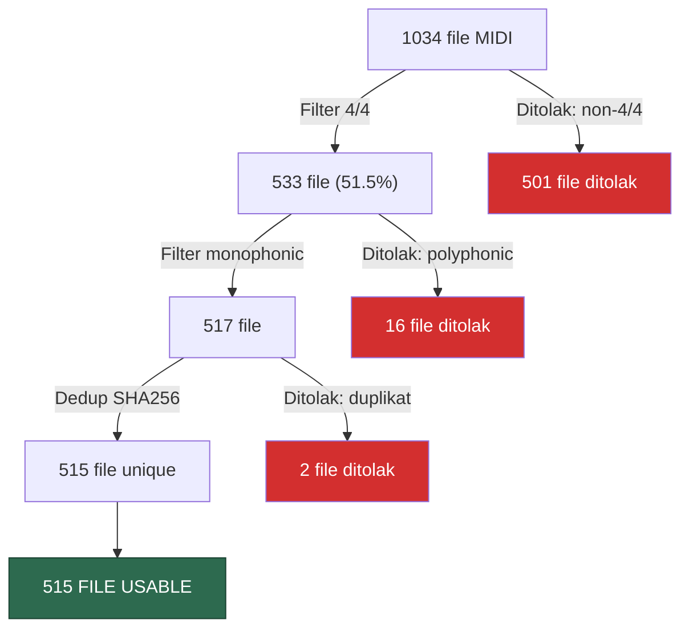

# Laporan Audit Dataset — Nottingham MIDI/melody

**Penyusun:** Member 2 (Data Pipeline & Preprocessing Engineer)
**Tanggal audit:** 28 Oktober 2026
**Kontrak data:** `nirava-midi-data-v1`
**Tokenizer:** `nirava-midi-step-v1` (V=133, grid 16 step/bar, 4/4 only)

---

## 1. Sumber Dataset

| Field | Nilai |
|---|---|
| Repository | [jukedeck/nottingham-dataset](https://github.com/jukedeck/nottingham-dataset) |
| Folder aktif | `MIDI/melody/` |
| Branch | `master` |
| Commit SHA | `0992bb6cd864f6d4b90d6663e08c0ef53ffaa08f` |
| Commit date | 2017-03-03T14:20:13Z |
| Tanggal akses | 28 Oktober 2026 |
| Lisensi repository | GPLv3 (LICENSE.md) |
| Asal data | Nottingham Music Database (ABC), dibersihkan dan dikonversi ke MIDI oleh Jukedeck |

> [!IMPORTANT]
> Label GPLv3 pada repository tidak otomatis berarti semua komposisi public domain atau boleh digunakan tanpa atribusi. Review hak komposisi/arrangement bersama tim dan dosen **masih diperlukan**.

---

## 2. Inventaris File

| Metrik | Nilai |
|---|---|
| Total file MIDI di folder melody | **1034** |
| File berhasil di-parse | 1034 (100%) |
| File gagal parse | 0 |
| File dengan notes | 1034 |
| File kosong | 0 |
| SMF type | Semua type 1 |
| PPQ (ticks per beat) | Semua 1024 |
| Pitched parts per file | Semua 1 |
| Drum parts | 0 |
| Total ukuran disk | **869 KB** |

---

## 3. Pipeline Filter dan Hasil

### Ringkasan Filter

| Filter | Input | Lolos | Ditolak | Keterangan |
|---|---|---|---|---|
| 1. Meter 4/4 eksplisit | 1034 | 533 | 501 | Hanya time signature 4/4 murni |
| 2. Monophonic | 533 | 517 | 16 | Tidak ada overlap note |
| 3. Deduplikasi SHA256 | 517 | 515 | 2 | File identik byte-for-byte |
| **Total** | **1034** | **515** | **519** | **49.8% retained** |

---

## 4. Distribusi Meter (Alasan Penolakan Terbesar)

| Time Signature | Jumlah Kemunculan | Status |
|---|---|---|
| 4/4 | 542 | ✅ Diterima |
| 6/8 | 373 | ❌ Ditolak (jig/compound meter) |
| 3/4 | 61 | ❌ Ditolak (waltz) |
| 2/4 | 43 | ❌ Ditolak |
| 9/8 | 16 | ❌ Ditolak (slip jig) |
| 2/2 | 7 | ❌ Ditolak |
| 3/2 | 3 | ❌ Ditolak |
| 5/4, 6/4 | 2 masing-masing | ❌ Ditolak |

> [!WARNING]
> **48.5% dataset ditolak** karena non-4/4. Ini bias signifikan — hampir seluruh kategori "jigs" (340 file, 6/8) dan "waltzes" (52 file, 3/4) hilang. Dataset usable didominasi "reels" dan "hpps" (hornpipes).

---

## 5. File Polyphonic yang Ditolak (16 file)

| Filename | Note Count | Durasi |
|---|---|---|
| ashover19.mid | 243 | 66.0s |
| reelsa-c30.mid | 261 | 81.5s |
| reelsa-c66.mid | 195 | 65.5s |
| reelsd-g1.mid | 492 | 129.5s |
| reelsd-g28.mid | 239 | 65.8s |
| reelsd-g41.mid | 275 | 66.0s |
| reelsd-g9.mid | 190 | 65.3s |
| reelsh-l57.mid | 210 | 64.0s |
| reelsh-l66.mid | 209 | 129.5s |
| reelsh-l80.mid | 335 | 130.0s |
| reelsh-l88.mid | 180 | 64.0s |
| reelsr-t10.mid | 194 | 65.5s |
| reelsu-z15.mid | 158 | 65.5s |
| reelsu-z3.mid | 180 | 64.0s |
| reelsu-z6.mid | 172 | 65.5s |
| xmas4.mid | 68 | 41.5s |

---

## 6. Duplikat Exact (SHA256)

| Grup | File | Aksi |
|---|---|---|
| 1 | hpps24.mid = hpps25.mid | Pertahankan hpps24, buang hpps25 |
| 2 | reelsa-c22.mid = reelsm-q24.mid | Pertahankan reelsa-c22, buang reelsm-q24 |

> [!NOTE]
> Near-duplicate (transposisi/arrangement yang secara byte berbeda tapi melodi serupa) **belum dianalisis**. Ini memerlukan tokenisasi dulu untuk membandingkan canonical sequences. Direncanakan di Fase C setelah tokenizer diimplementasikan.

---

## 7. Bias Akibat Filtering

| Kategori | Total | Usable | Ditolak | % Retained |
|---|---|---|---|---|
| **jigs** | 340 | 0 | 340 | **0.0%** |
| reelsr | 92 | 81 | 11 | 88.0% |
| reelsh | 90 | 78 | 12 | 86.7% |
| reelsd | 84 | 78 | 6 | 92.9% |
| reelsa | 81 | 68 | 13 | 84.0% |
| reelsm | 80 | 74 | 6 | 92.5% |
| hpps | 65 | 64 | 1 | 98.5% |
| **waltzes** | 52 | 0 | 52 | **0.0%** |
| ashover | 46 | 13 | 33 | 28.3% |
| reelsu | 34 | 30 | 4 | 88.2% |
| morris | 31 | 17 | 14 | 54.8% |
| playford | 15 | 7 | 8 | 46.7% |
| xmas | 13 | 5 | 8 | 38.5% |
| **slip** | 11 | 0 | 11 | **0.0%** |

**Bias penting:**
- Dataset usable **79.4% reels** (409/515) — model akan belajar dominan dari gaya reel
- Seluruh jigs, waltzes, dan slip jigs hilang (0% retained)
- Kategori minoritas (ashover, morris, playford, xmas) hanya 42 file (8.2%)

---

## 8. Statistik File Usable (515 file)

### Note Count
| Rentang | Jumlah File |
|---|---|
| 0–49 | 8 |
| 50–99 | 55 |
| 100–199 | 268 |
| 200–299 | 138 |
| 300–499 | 35 |
| 500–1104 | 11 |

- **Min:** 17 notes | **Max:** 1104 notes | **Mean:** 186.4 notes
- **Total notes:** 96,005

### Durasi
| Rentang | Jumlah File |
|---|---|
| 0–30s | 18 |
| 30–60s | 83 |
| 60–100s | 377 |
| 100–200s | 29 |
| 200–450s | 8 |

- **Mean:** 70.4s | Mayoritas (73%) berada di rentang 60–100 detik

---

## 9. Estimasi Kecukupan Data untuk Training

| Metrik | Estimasi |
|---|---|
| Total notes | 96,005 |
| Estimasi total grid steps | ~144,000 (asumsi ~1.5 step/note rata-rata) |
| Training windows (128 step) | ~1,125 |
| Dengan augmentasi ±6 transposisi | ~14,625 windows |
| Piece untuk split 80/10/10 | ~412 train / 51 val / 52 test |

> [!NOTE]
> **~1,125 windows** dari 515 pieces adalah dataset kecil untuk LSTM. Augmentasi transposisi akan membantu, tapi risiko memorization tetap tinggi. Ini harus didiskusikan dengan tim/dosen dan dilaporkan secara transparan.

---

## 10. File yang Dihasilkan Audit Ini

| File | Isi |
|---|---|
| [`reports/midi_manifest.csv`](file:///c:/Users/Haikal/Downloads/-Proyek1-AI-Voice-Cleaner-/reports/midi_manifest.csv) | Manifest lengkap 1034 file: SHA256, SMF type, PPQ, meter, polyphony, dll |
| [`reports/dataset_exclusions.csv`](file:///c:/Users/Haikal/Downloads/-Proyek1-AI-Voice-Cleaner-/reports/dataset_exclusions.csv) | 519 file ditolak dengan alasan |
| [`reports/dataset_usable.csv`](file:///c:/Users/Haikal/Downloads/-Proyek1-AI-Voice-Cleaner-/reports/dataset_usable.csv) | 515 file usable final |
| [`reports/duplicate_groups.csv`](file:///c:/Users/Haikal/Downloads/-Proyek1-AI-Voice-Cleaner-/reports/duplicate_groups.csv) | 5 grup duplikat SHA256 |
| [`reports/midi_audit.csv`](file:///c:/Users/Haikal/Downloads/-Proyek1-AI-Voice-Cleaner-/reports/midi_audit.csv) | Audit dasar note count/pitch range |

---

## 11. Checklist Audit A2 — Status

- [x] Sumber dan folder dipilih pengguna
- [x] Pin commit SHA upstream: `0992bb6cd864f6d4b90d6663e08c0ef53ffaa08f` (2017-03-03)
- [ ] Review hak komposisi/arrangement bersama tim/dosen
- [x] Inventory: 1034 files, 869 KB total
- [x] Audit SMF type (semua type 1), PPQ (semua 1024), pitched parts (semua 1), no drums
- [x] Audit meter: 533 file 4/4 (51.5%), 501 non-4/4
- [x] Audit polyphony: 16 file polyphonic di 4/4
- [x] Audit duplikat SHA256: 2 duplikat di usable set
- [x] Dokumentasi distribusi, exclusions, dan bias filtering
- [x] Laporan kecukupan data
- [ ] Near-duplicate/arrangement grouping (memerlukan tokenisasi)
- [ ] Split work-disjoint (setelah grouping)
- [ ] Round-trip test (setelah tokenizer diimplementasikan)

---

## 12. Risiko dan Rekomendasi

1. **Dataset kecil**: 515 files / ~1,125 windows. Augmentasi transposisi membantu tapi memorization harus dipantau ketat.

2. **Bias genre**: 79.4% reels. Model mungkin hanya belajar gaya reel. Ini **harus dilaporkan** dalam evaluasi, bukan disembunyikan.

3. **Jigs hilang seluruhnya**: 340 file (33% dataset) ditolak karena 6/8. Jika dosen meminta cakupan lebih luas, opsi:
   - Perluas tokenizer ke 6/8 (perubahan kontrak, perlu review A1/A3/dosen)
   - Atau terima keterbatasan dan dokumentasikan

4. **Near-duplicate belum dianalisis**: Filename hints (reelsa/reelsd/dst) menunjukkan kemungkinan melodi serupa lintas koleksi. Perlu similarity analysis setelah tokenisasi.

5. **Hak data**: GPLv3 repository ≠ public domain komposisi. Perlu klarifikasi tim/dosen.

---

## 13. Hasil Pilot Tokenizer (nirava-midi-step-v1) — 28 Oktober 2026

Implementasi: `src/nirava_midi_tokenizer.py` (stdlib saja, tanpa dependensi baru). Tes: `tests/test_nirava_midi_tokenizer.py` (17 tes lulus). Runner: `src/run_tokenizer_audit.py`. Detail per file: `reports/tokenizer_audit.csv`, ringkasan: `reports/tokenizer_audit_summary.txt`. Tokenizer hash: `21c0930e...a6a9bba`.

| Metrik | Hasil terukur |
|---|---|
| File diproses | 1034 |
| Ter-encode | **519** |
| Ditolak non-4/4 | 501 |
| Ditolak overlap setelah quantization | 14 |
| Round-trip (encode → export → parse → encode) | **519/519 identik** |
| Total langkah / token | 288.368 / 289.406 |
| Langkah per piece (min/median/maks) | 96 / 512 / 3584 |
| Window 128, stride 128 (sebelum dedup) | 2.753 |
| Rata-rata error quantization | 0,0051 langkah per file |
| Error quantization maksimum | 0,336 langkah |
| File dengan event off-grid (>0,25 langkah) | 105 (total 3.060 event) |
| Durasi diperpanjang ke minimum 1 langkah | 0 file |
| Grup token identik | 2 (sama dengan duplikat SHA256) |

**Koreksi dan catatan:**
- Estimasi window di Bagian 9 (~1.125) **tidak akurat**. Angka terukur ~2.753 window (sebelum dedup dan sebelum split).
- Jumlah usable berbeda dari Bagian 3 (515): tokenizer menghitung 519 sebelum dedup, atau 517 setelah dedup 2 grup. Dugaan penyebabnya (belum diverifikasi per file), pemeriksaan overlap di manifest memakai detik pretty_midi, sedangkan tokenizer memakai grid hasil quantization. Angka final harus mengikuti tokenizer. Selisihnya ada pada file yang ditolak sebagai overlap (14 dibanding 16 di manifest) dan belum dirinci per file.
- Bug awal yang ditemukan dan diperbaiki: semua file 4/4 sempat ditolak karena pitch-bend netral (8192) di tick 0 dianggap bend aktif. Kontrak hanya menolak bend/pedal **aktif**, jadi bend netral dan pedal off kini diterima dan dicatat lewat tes.
- Round-trip hanya membuktikan konsistensi encode/export/parse tokenizer sendiri terhadap melodi canonical. Ini bukan bukti musikal bahwa hasil quantization setia pada sumber. 105 file punya event off-grid (kemungkinan triplet atau swing) yang digeser ke grid terdekat.
- Belum dikerjakan: near-duplicate/work grouping, split work-disjoint, windowing/DataLoader, dan review A1/A3 atas tokenizer.

---

## 14. Grouping, Split, dan Windowing (pilot) — 28 Oktober 2026

Kode: `src/nirava_midi_grouping.py`, `src/build_splits.py`, `src/nirava_midi_data.py`. Tes: `tests/test_nirava_midi_data.py` (11 tes; total 28 tes lulus). Output: `reports/split_manifest.csv`, `reports/work_groups.csv`, `reports/split_exclusions.csv`, `reports/split_summary.txt`. Token ada di `processed/tokens_v1.jsonl`, yang sekarang masuk `.gitignore`.

**Metode grouping.** Fingerprint n-gram (n=6) dari (interval, durasi, jeda) per note, sehingga invarian terhadap transposisi. Kemiripan Jaccard antar piece, lalu union-find. Ambang 0,25 dipilih konservatif (cenderung menggabung) dari distribusi pasangan: ada 84 pasangan dengan sim > 0,05, dan pada ambang 0,2 grup terbesar hanya 3 file. Sampel pasangan di rentang 0,25 sampai 0,45 kebanyakan berupa file bernomor bersebelahan (mis. `reelsd-g76/g77`, `reelsh-l34/l35`), yang kemungkinan varian tune yang sama. Ambang ini keputusan teknis yang belum direview A1/A3 dan bukan kebenaran mutlak.

| Split | Piece | Work group | Langkah | Token |
|---|---|---|---|---|
| train | 414 | 395 | 230.176 | 231.004 |
| validation | 52 | 51 | 28.048 | 28.152 |
| test | 51 | 48 | 29.120 | 29.222 |

- 519 ter-encode, 2 dibuang karena token identik, jadi 517 dipakai. Total 494 work group, 22 di antaranya berisi lebih dari satu file.
- Window 128 stride 128: train 2.197, validation 269, test 277 (dihitung dari loader nyata).
- Seed split 20261028, deterministik.
- Pemeriksaan leakage: group lintas split = 0 dan token identik lintas split = 0. Kedua pemeriksaan ini benar **secara konstruksi**, jadi bukan bukti independen. Pemeriksaan independen: kemiripan maksimum tiap piece validation/test terhadap train adalah 0,239 (validation) dan 0,070 (test), tanpa pasangan di atas 0,25. Dua piece validation berada di 0,15 sampai 0,25 dan perlu ditinjau manual.
- Hanya piece yang terjangkau fingerprint 6-gram yang bisa digrup. Melodi mirip dengan ritme berbeda, atau transposisi dengan variasi ornamen, bisa lolos. Leakage nol yang terdeteksi bukan jaminan leakage nol.
- Sekitar 79% data adalah reels (lihat Bagian 7), jadi split mewarisi bias ini. Validation/test tidak dijamin mewakili jigs, waltzes, atau slip jigs.
- Window terakhir tiap piece bisa berisi hanya 1 target (EOS saja). Ini sah menurut kontrak (lengths 1..128).

**Belum dikerjakan:** augmentasi transposisi (opsional, train-only), review A1/A3 atas tokenizer, ambang grouping, dan interface loader, serta pembungkus torch oleh Member 3 setelah torch tersedia.

---

## 15. Environment, Torch Adapter, dan Augmentasi — 28 Oktober 2026

**Environment:**
- Python 3.12.10 via winget, venv di `D:\nirava-venv`
- torch 2.15.0+cpu (PyTorch CPU only, ~200 MB)
- GPU tersedia: NVIDIA RTX 5060 8 GB (CUDA build bisa dipasang nanti oleh A3 jika diperlukan)
- `requirements.txt` di root proyek

**Torch adapter:** `src/nirava_midi_torch.py`. Membungkus batch Python menjadi tensor `int64[B,128]`, `bool[B,128]`, `int64[B]`. `validate_batch` memeriksa dtype, shape, range 0..132, loss_mask konsisten dengan lengths, dan PAD posisi. `TorchMidiLoader` mengiterasi batch tensor per split dengan seed per epoch.

**Augmentasi transposisi:** `src/augment_transpose.py`. Train-only, ±5/+6 semitone (11 offset, total 12 versi termasuk asli). Pitch yang keluar 0..127 dilewati, bukan di-clip. Lineage `parent_piece_id` dan `transpose_offset` dicatat. Validation/test disalin apa adanya.

| Dataset | Train windows | Val windows | Test windows |
|---|---|---|---|
| Tanpa augmentasi | 2.197 | 269 | 277 |
| Dengan augmentasi | **26.364** | 269 | 277 |

**Tes baru (6 tes torch):**
- dtype/shape `int64[B,128]` dan `bool[B,128]` ✅
- target = shifted input ✅
- loss_mask/PAD konsistensi ✅
- reject batch invalid ✅
- ketiga split pada data nyata + determinisme loader ✅
- seluruh batch real valid + tidak ada work group lintas split ✅

Total tes: **34 lulus, 0 gagal.**

**File baru:**
- `src/nirava_midi_torch.py` — adaptor torch
- `src/augment_transpose.py` — augmentasi train-only
- `tests/test_nirava_midi_torch.py` — 6 tes
- `requirements.txt` — dependensi
- `processed/tokens_v1_aug.jsonl` — dataset augmentasi (tidak di Git)
