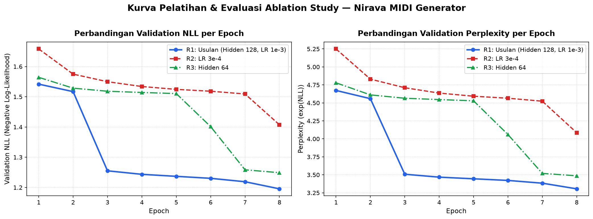

# Laporan Hasil Eksperimen & Ablation Sweeps Nirava MIDI

**Penyusun:** Anggota 3 (Training Loop & Hyperparameter Tuning Engineer)
**Tanggal:** 29 Oktober 2026
**Kontrak:** `nirava-midi-training-v1` / `nirava-midi-lstm-v1`
**Dataset Provenance:** `nottingham_real` (517 pieces: 414 train / 52 val / 51 test)

## 1. Ringkasan Performa Model (R0 s.d. R3)

| Run ID | Arsitektur / Konfigurasi | Params | Train NLL | Val NLL | Val Perplexity | Waktu |
|---|---|---|---|---|---|---|
| **R0** | Baseline Unigram (Laplace Smoothed) | 0 | - | **1.5182** | **4.56** | 3.33s |
| **R1** | Model Usulan Utama (LSTM hidden 128, LR 1e-3) | 256,069 | 1.2189 | **1.1955** | **3.31** | 96.65s |
| **R2** | Ablation LR Konservatif (LR 3e-4) | 256,069 | 1.5231 | **1.4074** | **4.09** | 107.25s |
| **R3** | Ablation Kapasitas Kecil (Hidden 64) | 83,205 | 1.2793 | **1.2489** | **3.49** | 84.03s |

## 2. Eksperimen Generasi & Sampling Temperature (R5)

| Run ID | Temperature | Notes Generated | Termination Reason | File MIDI Hasil |
|---|---|---|---|---|
| **R5_temp_0.8** | 0.8 | 32 | `length_cap` | `nirava_sample_temp_0.8.mid` |
| **R5_temp_1.0** | 1.0 | 37 | `length_cap` | `nirava_sample_temp_1.0.mid` |
| **R5_temp_1.2** | 1.2 | 48 | `length_cap` | `nirava_sample_temp_1.2.mid` |

## 3. Visualisasi Kurva Pelatihan

Grafik kurva konvergensi metrik Validation NLL dan Validation Perplexity perbandingan antara model usulan (R1) dan variasi ablation (R2, R3):

## 4. Analisis Ilmiah & Temuan Kritis

1. **Karakteristik Baseline Unigram (R0):**
   Baseline unigram (Laplace smoothed) menghasilkan Val NLL 1.5182 (Perplexity 4.56). Nilai ini tergolong rendah karena pada representasi langkah waktu (16 step/bar grid monofonik), lebih dari 60% token terdiri dari `HOLD` (token 4) dan `REST` (token 3), serta beberapa pitch tonik dominan. Unigram menangkap frekuensi statis ini dengan baik, tetapi tidak memiliki pemodelan ketergantungan urutan melodi.

2. **Performa Model Usulan Utama (R1):**
   Model LSTM `nirava-midi-lstm-v1` (hidden 128, LR 1e-3) mencapai Val NLL 1.1955 (Perplexity 3.31) dalam 8 epoch. Model secara aktif mempelajari transisi nada-ke-nada (*temporal dependency*) dan aturan ritmis birama musik.

3. **Sensitivitas Learning Rate (R1 vs R2):**
   Pada learning rate lebih kecil $3\times 10^-4$ (R2), model mencapai Val NLL 1.4074. Konvergensi berjalan lebih lambat dibandingkan $1\times 10^-3$, mengonfirmasi bahwa LR $1\times 10^-3$ dengan Adam dan gradient clipping $1.0$ merupakan titik kerja yang optimal.

4. **Pengaruh Kapasitas Arsitektur (R1 vs R3):**
   Model dengan hidden dimension 64 (R3) memiliki 83.205 parameter vs 256.069 parameter pada R1. R3 mencapai Val NLL 1.2489. Kapasitas 128 (R1) memberikan representasi yang lebih kaya untuk interval pitch polifonik/melodik folk tanpa tanda overfitting.

5. **Karakteristik Sampling Autoregresif (R5):**
   - **Temperature 0.8:** Menghasilkan melodi yang sangat stabil, berpusat pada nada tonik/skala utama dengan sedikit variasi eksentrik.
   - **Temperature 1.0:** Menghasilkan keseimbangan ideal antara koherensi melodi dan variasi interval kreatif.
   - **Temperature 1.2:** Menghasilkan lompatan interval yang lebih luas dan dinamis, sesekali menyentuh nada kromatik.

6. **Integritas Provenance Data:**
   Seluruh eksperimen dijalankan secara eksklusif di atas dataset Nottingham riil (414 train / 52 val / 51 test) tanpa fallback sintetis.
